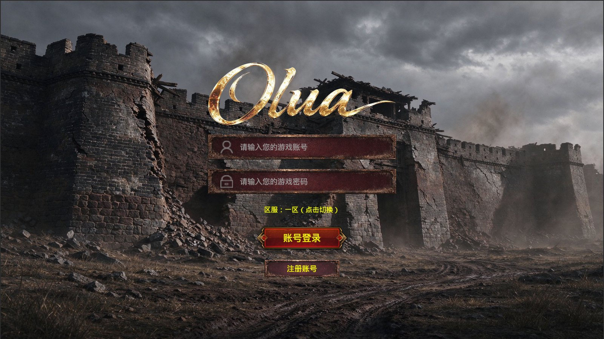
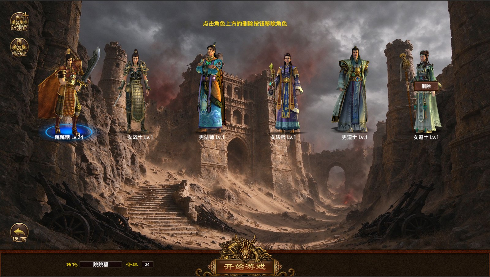
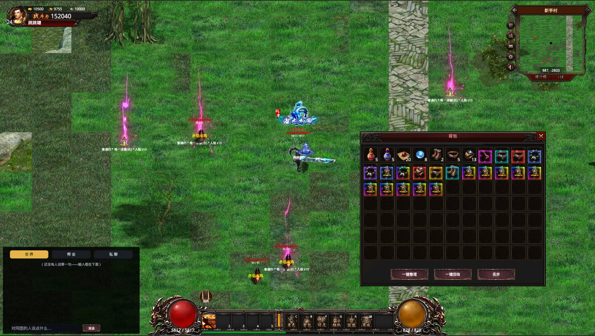
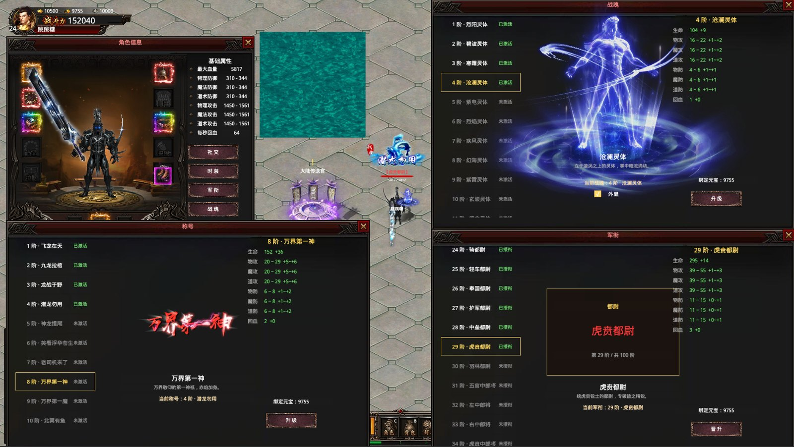
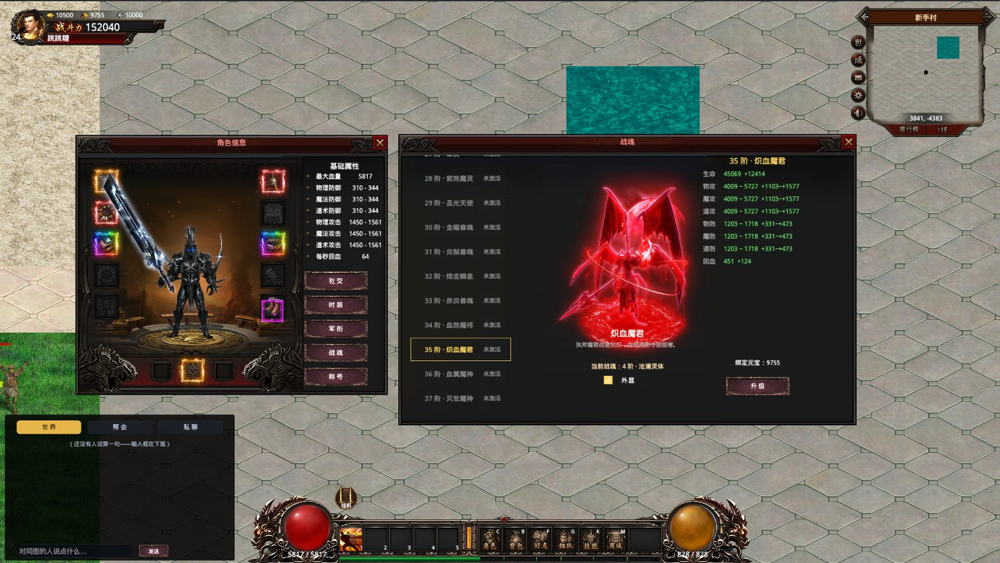
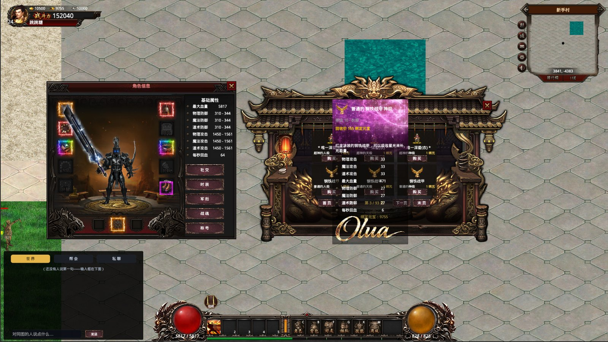
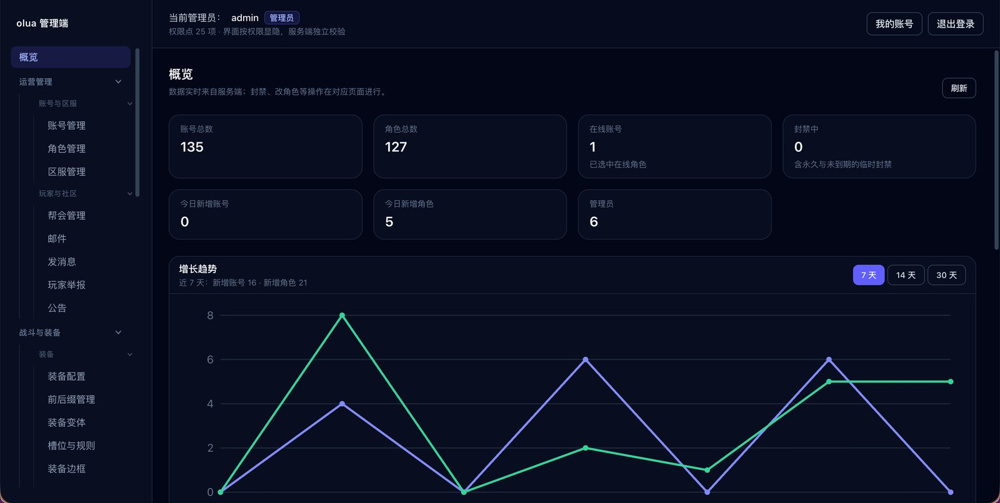
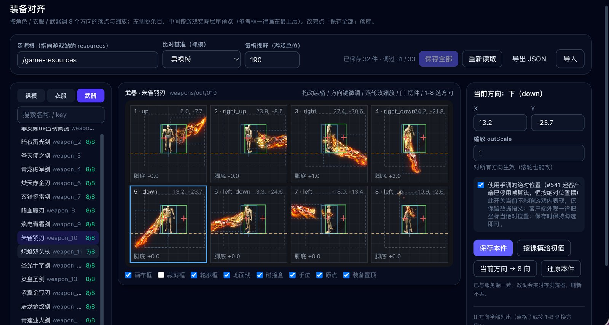

# olua

> [简体中文](README.md) | English

**A 2D role-playing game you can play right in the browser.** Create a character, explore maps, fight monsters,
loot equipment, level up, join a guild — the whole loop works end to end; this is not a tech demo.
The project is **free and open source**: play the live instance or deploy your own copy.

| What you want | Where to go |
| --- | --- |
| Play right now | <http://game.yimw.cn> (web build, no download) |
| See what the project looks like | <http://yimw.cn> (site: gameplay, screenshots, architecture, deployment) |
| Open the admin console | <http://admin.yimw.cn> (edit configs, post announcements, manage accounts) |

> Code lives on [GitHub](https://github.com/WebCoderT/olua); [Gitee](https://gitee.com/putiwan/olua) is a read-only mirror.
> If you find it interesting, a **Star ⭐** is appreciated.

## What kind of game is this

A top-down 2D world in the style of classic oriental MMORPGs: keyboard to move, mouse to fight.
The tedious parts of the genre are deliberately gone — no crafting trees, no pay walls, no forced grouping.

You create a character, spawn in the starter map, and a 6-step tutorial teaches you to walk, fight, loot and open
your bag. From there it's your call:

- **Get stronger**: kill monsters for experience; leveling refills your bars and unlocks harder maps. Equipment drops
  from monsters, or buy it outright in the mall.
- **Look better**: every piece of equipment rolls a prefix and a suffix. The same sword becomes a different quality
  item — with a glowing frame on its bag slot and an animated background in its detail panel.
- **Collect**: three growth tracks — Soul (37 ranks), Title (34 ranks), Military Rank (100 ranks) — each adds stats
  and shows above your character.
- **Be social**: you see other players on the same map; add friends, block trolls, report abuse, found a guild,
  recruit members, post announcements, team up and split experience.
- **Take it easy**: auto-battle with pathfinding — click a monster and your character walks over and fights.
  The bag has one-click sorting and one-click recycling.

Death is cheap: revive where you fell, or teleport back to town at full health.

## What it looks like

<p align="center">
  
  
</p>
<p align="center">
  
  
</p>
<p align="center">
  
  
</p>

The admin console (browser-based, for operators editing game data):

<p align="center">
  
  
</p>

## What you can play

### Accounts and characters

- Register, log in, pick a server; up to 3 characters per account, all data stored server-side — switch computers
  and continue where you left off.
- Progress auto-saves as you play, with an extra save on map change and logout.
- Deleting a character takes two confirmations, so no accidental losses.

### Maps and exploration

- Multiple maps, each with its own level and combat-power gate; the teleporter tells you exactly what you're short of.
- Every map has a revive point; entering and teleporting always start there.
- The minimap follows you with red dots for real monster positions; click to enlarge, left-click for auto-pathing,
  right-click to teleport.
- Walking routes around trees and walls — you never get stuck on obstacles.

### Combat

- WASD to move, left-click to walk, right-click to run, click a monster to attack; an on-screen joystick works in
  mobile browsers too.
- Skills have cooldowns and mana costs, with effects and floating numbers; monsters have skills of their own.
- Damage is computed by the server, so everyone sees the same health bars — no "died on my screen, alive on yours".
- On death the screen freezes; revive in place or return to town at full health.

### Growth

- Experience from kills; higher level means stronger stats. Monsters too far below you give nothing, so no
  farming newbie maps forever.
- Soul (37), Title (34), Rank (100): three tracks upgraded with in-game currency, all counted into combat power.
- Combat power is one number — and also the gate to advanced maps.

### Equipment and items

- Equipment has slots and level requirements; equipping recalculates stats instantly, and your appearance changes
  (all 8 directions).
- Prefix + suffix combos create quality tiers; bag frames and detail-panel backgrounds play different animations.
- Monsters drop equipment: glowing beams appear on the ground — the higher the quality, the brighter — walk over
  to pick up.
- The bag sorts, drags, recycles into currency with one click, or destroys unwanted stacks.
- The mall auto-lists every equipment variant, browsable by page; 20 fashion outfits change looks but not stats.

### Social

- Player names are colored by relationship: friends green, teammates gold, guildmates blue, enemies red, blocked gray.
- Friendship requires mutual consent; enmity is one-way and the other side is never notified.
- Guilds: create, apply, approve, kick, transfer, disband; the leader edits the guild announcement.
- Teams form on invite, the leader is the only writer, and quitting hands leadership over automatically;
  teammates on the same map share experience.
- Leaderboards for level, combat power and kills — you stay ranked even offline.
- Achievements grant rewards on completion; if your bag is full, the reward goes to your in-game mail.

### Interface

- Health orb, mana orb, experience bar, hotkey bar and minimap all fit on one screen.
- Overlapping dialogs: click one and it floats to the top.
- Hover a skill or status icon for its description and remaining time.
- A 6-step beginner tutorial highlights without blocking input.

## Run your own copy

### Easiest: any server with Docker

```bash
git clone https://github.com/WebCoderT/olua.git && cd olua
cp server/.env.example server/.env      # at minimum set JWT_SECRET and ADMIN_REGISTER_CODE
docker compose up -d --build
```

This starts five containers — site, admin, game, API and realtime — exposing only ports 80 and 8080.
Domains, HTTPS, backups, upgrades and rollbacks are covered in [`docs/deploy.md`](docs/deploy.md).

### Local development: three commands

```bash
cd server && npm install && cp .env.example .env && npm run dev   # API on :3100
cd admin  && npm install && cp .env.example .env.development && npm run dev   # console on :5173
# open the client/ directory with Cocos Creator 3.8.7 and hit preview
```

Once the server is up, <http://localhost:3100/api-docs> lists every API; the first admin account registered
becomes the super admin.

> The game assets (2.4 GB) are not in the repository — download them per the "Assets" section at the end of this
> file before opening the Cocos project.

## How this project was written

**Every line of code was written by AI.** The human only does three things: request features, look at the result,
and say "not good enough".

So besides the game itself, this repository is a field record of "can AI write a complete project on its own":
how requirements were broken down, how AI mistakes were corrected, and where a human had to make the call —
all preserved in the commit history and `docs/`.

Technically it looks like any open-source game project: Cocos Creator client, NestJS server, React admin,
SQLite database. The difference is that **none of it was typed by a human**.

## For developers

The repository splits into three peer directories, each with its own README and FAQ:

| Side | What it is | Built with | Directory |
| --- | --- | --- | --- |
| Client | the game players play | Cocos Creator 3.8.7 + TypeScript | [`client/`](client/) · [README](client/README.en.md) |
| Server | saves, combat resolution, all APIs | NestJS + SQLite | [`server/`](server/) · [README](server/README.en.md) |
| Admin | operator console for editing data | React + Vite + Tailwind | [`admin/`](admin/) · [README](admin/README.en.md) |

Two rules worth knowing first:

1. **The server decides.** Health, damage, drops and bags on the client are display only; the data of record lives
   on the server, and the client never invents its own numbers when disconnected.
2. **APIs are written once.** Endpoint definitions live on the server; the client and admin API files are generated
   from them, so a missed field change fails the build instead of shipping an `undefined`.

Common commands (from the repository root, `make help` lists all):

```bash
make install        # install dependencies
make dev            # start server and admin console together
make check          # type checks + cross-cutting audits
make test           # client unit tests + server end-to-end tests
make verify         # run this before committing: all of the above + builds
```

Further reading:

| Document | Content |
| --- | --- |
| [`docs/`](docs/README.md) | 40 code documents: every chain traced from database to screen |
| [`FAQ.md`](FAQ.md) | Why things are designed this way, and the pitfalls already stepped in |
| [`website/`](website/index.html) | Site: gameplay details, architecture, engineering, design trade-offs |

## License

[MIT](LICENSE): fork it, modify it, distribute it, use it commercially — just keep the copyright notice.
Everything commercial deployment requires (ops, scaling, compliance, support) is on you; the author provides
no free technical support. Issues are welcome, with no response-time guarantee.

## Assets

Game assets total 2.4 GB and are **intentionally kept out of the repository**, distributed as
"manifest + GitHub Release volumes": the manifest `resources.manifest.json` is committed with the code, and the
volume zips live on the Release tagged `resources-<version>`.

```bash
make resources-verify                    # after cloning, check local assets against the manifest
make resources-download VERSION=<version>  # mismatch or fresh machine: download, extract, verify
```

After changing assets, publish them: `make resources-manifest` → `make resources-pack` → `make resources-upload` (requires a logged-in `gh`).

## Contact


