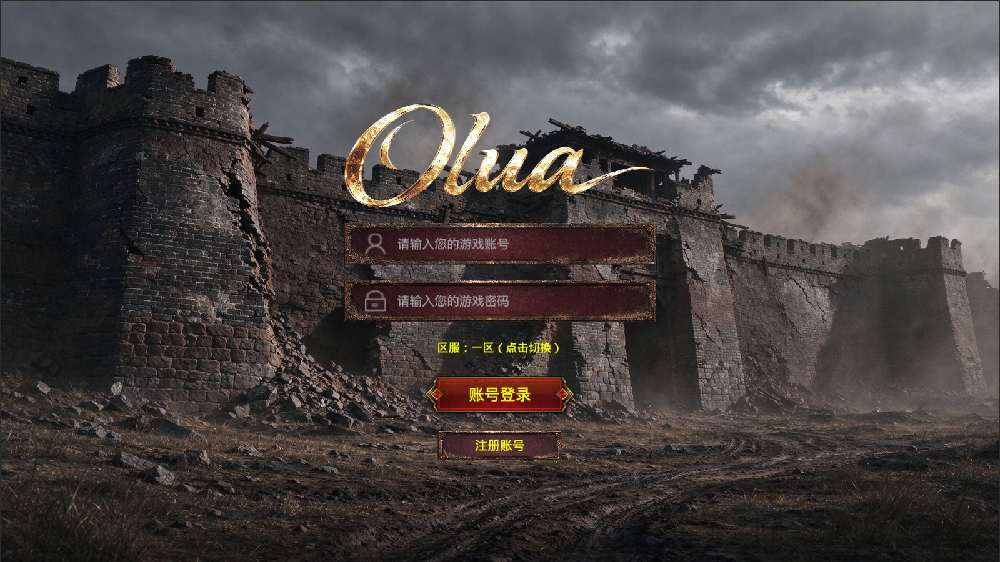
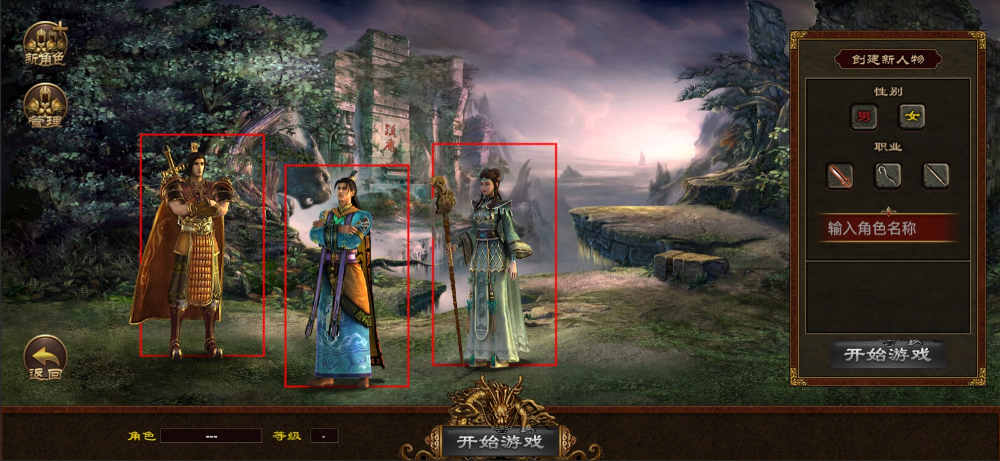
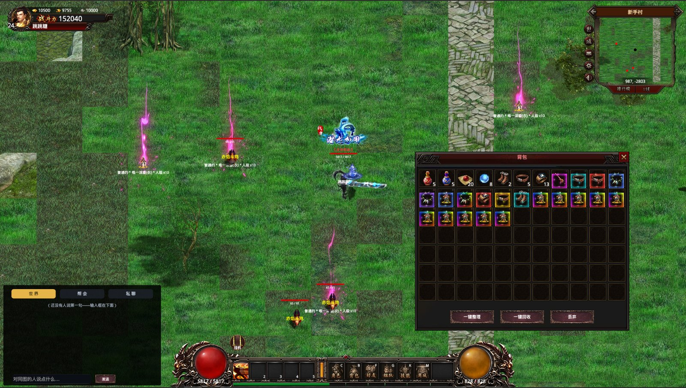
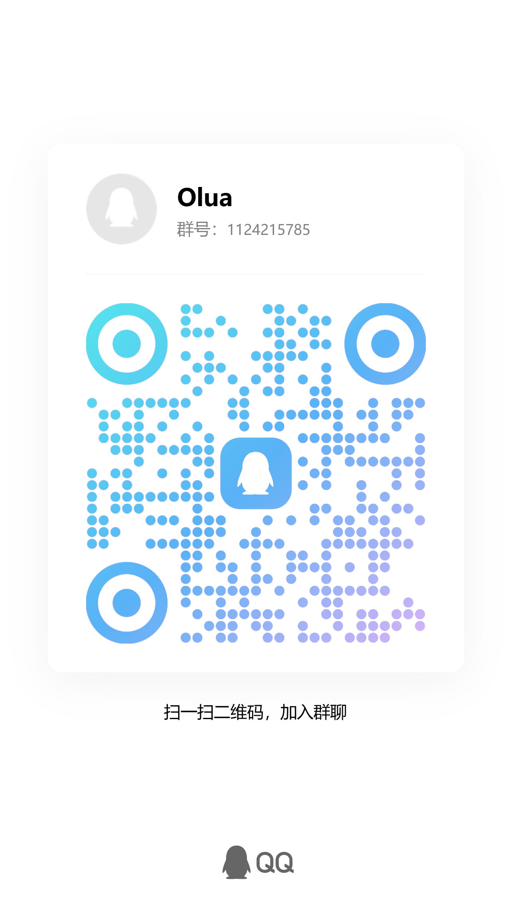

# olua

> [简体中文](README.md) | English

> **A learning project written entirely by AI (Vibe Coding)**: every line of code in this repository is AI-written; humans only request features and look at the result.
> **It is NOT a game ready for live operation** — it is a learning / research project by a few people from development and AI backgrounds.

A 2D character-growth and equipment prototype built on Cocos Creator 3.8.7, together with a NestJS server and a React admin console:
the three sides run login, character creation, growth, equipment, map exploration and combat end to end.

The primary repository lives on **GitHub** (`github.com/WebCoderT/olua`); [putiwan/olua](https://gitee.com/putiwan/olua) on Gitee is a read-only sync mirror —
code, issues, PRs and CI all happen on GitHub (the mirror syncs periodically, may lag, and GitHub is authoritative).

[](https://gitee.com/putiwan/olua/stargazers)
[](https://gitee.com/putiwan/olua/members)

## The three sides

The repository splits into three **peer directories**, each with its own README and FAQ.

| Side | What it is | Tech stack | Directory | Docs |
| --- | --- | --- | --- | --- |
| **Client** | The Cocos Creator game (login / character select / combat / bag / mall…) | Cocos Creator 3.8.7 + TypeScript | [`client/`](client/) | [README](client/README.en.md) · [FAQ](client/FAQ.en.md) |
| **Server** | Account / character / admin APIs, SQLite persistence, Swagger docs | NestJS 12 + `node:sqlite` + JWT | [`server/`](server/) | [README](server/README.en.md) · [FAQ](server/FAQ.en.md) |
| **Admin** | The operator console (accounts / characters / announcements / logs / maps) | React 19 + Vite + Tailwind v4 | [`admin/`](admin/) | [README](admin/README.en.md) · [FAQ](admin/FAQ.en.md) |

The client is the game the player plays, the server is the only authoritative data source (local storage is just a cache), and the admin lets operators edit data.
The API contract is generated one-way from the server to the other two sides:

```
client (Cocos)    ─┐
                   ├─→  server (NestJS + SQLite)  ←─  admin (React)
admin (React)    ─┘      ↑ the only hand-written place for APIs
                         └─ swagger:emit → openapi.json → gen-api → generated API files on both consumers
```

## Screenshots







## Quick start

The shortest path to a running stack. Each side's README has the details and every environment variable.

### 1. Server (start it first — the client and admin depend on it)

```bash
cd server
npm install
cp .env.example .env     # first time: port / secrets / limits all live here, explained in the comments
npm run dev              # development (watch mode); or npm run start for the built output
```

- API docs: <http://localhost:3100/api-docs> (JSON at `/api-docs-json`)
- Health check: <http://localhost:3100/api/health>
- Verify everything with one command: `npm run verify`

### 2. Client (Cocos)

1. Install and open Cocos Creator 3.8.7.
2. Open **`client/`** through Creator's "Open" / "Open Project" (it is the Cocos project root).
3. In the editor, open a scene under `client/assets/scenes`.
4. Run the project with the preview or play button.

The client has no npm scripts; it relies on the Cocos Creator editor to launch and preview.
Which server it talks to is decided solely by `baseUrl` in `client/assets/configs/network.ts` (use the LAN IP for on-device debugging).

### 3. Admin (React)

```bash
cd admin
npm install
cp .env.example .env.development   # first time: the API base URL lives here (VITE_API_BASE_URL)
npm run dev                        # development; npm run build produces dist
```

Admin registration needs `ADMIN_REGISTER_CODE` set in `server/.env` (leave it empty for open registration), and registration asks for the same code.
The **first** administrator to register becomes the super administrator (all permissions); later ones are promoted by the super admin on the "Administrators" page.

### 4. Changing an API = changing the server + regenerating

The client and admin **hand-write no API files at all**: paths, method names, request / response types are all produced from the server's Swagger document.
That way "the server changed a field and the other two forgot" becomes a **compile error** instead of an `undefined` in production.

```bash
cd server && npm run gen:api     # = swagger:emit + node ../tools/gen-api.cjs
```

```
server/src (controller + DTO + decorators)  ← the only hand-written place
        │  cd server && npm run swagger:emit
        ▼
server/openapi.json (machine-readable contract, committed to the repo)
        │  node tools/gen-api.cjs
        ▼
client  client/assets/ui/utils/net/{ApiRoutes,ApiModels,Api}.ts
admin   admin/src/api/{routes,models,endpoints}.ts
```

The standard steps: change the server's controller / DTO / decorators (every endpoint needs an `operationId`) → `npm run gen:api` →
`tsc` / `npm run build` on both consumers, where incompatible signatures fail the build. **Never hand-edit the generated files** — `tools/audit-api-generated.cjs` watches them.

## Common commands

The repository root ships a Makefile collecting the three sides' routine actions in one place (`make help` lists everything):

```bash
make install        # first time: install server / admin dependencies
make env            # generate server/.env (skipped if it already exists)
make dev            # start server :3100 and admin :5173 together; Ctrl-C exits both

make client-check   # client typecheck (Cocos' bundled tsc; 0 errors means pass)
make client-test    # client unit tests
make server-verify  # verify the server with one command (compile + e2e + generated-artifact audit)
make admin-build    # admin typecheck + build
make gen-api        # after changing APIs: regenerate the contract and both consumers' API files
make audit          # cross-side audit scripts

make check          # static checks: client tsc + admin typecheck + audits
make test           # all tests: client unit tests + server e2e
make verify         # full gate: check + builds on all three sides + all tests (run before committing)
```

- Run a single client suite: `make client-test-one T=test-bag-tidy`
- Different machine / different Cocos version: `make TSC=/path/to/tsc client-check`
- Restricted terminals (with `NODE_OPTIONS` injected) need no special handling — the Makefile clears it already

## Resource sync (resources are not in the repo)

`client/assets/resources/` is large and **deliberately not in the repository**. Multiple people / machines stay in sync with a "manifest lock + GitHub Release distribution":

- **Manifest**: `resources.manifest.json` is committed, recording every file's sha1 + size (including `.meta` — Cocos uuids live on the meta files).
- **Distribution**: split zip volumes are attached to a GitHub Release (tag = `resources-<version>`).

```bash
make resources-verify                      # run after pulling: local resources vs the manifest
make resources-download VERSION=<v>        # when out of sync or on a new machine: download, extract, verify
```

After changing assets, the person who changed them publishes: `make resources-manifest` → `make resources-pack` → `make resources-upload` (needs `gh` logged in).
Convention: **merge the PR carrying the new manifest first, then run upload**.

## Feature list

Implemented features only; each side's README covers its own capabilities in more detail.

### Account and characters

| Feature | Notes |
| --- | --- |
| Sign-up / login | Accounts live on the server, passwords are scrypt-hashed with a salt, tokens last 7 days |
| Character select and creation | Up to 3 characters per account, list and data both on the server |
| Cloud save | Changes are debounced and pushed together after 1.5 seconds, flushed immediately on map change and logout |
| Save migration | Missing fields are filled in automatically when a save is read |
| Delete character | Two-step confirmation on the select screen, deleted by the server |
| Admin account and character management | Multi-criteria filtering, structured editing, batch delete, password reset, force logout |
| Audit log | Every admin write endpoint is logged automatically; password-like fields are masked before storage |
| Permissions | Super administrator / administrator / read-only viewer, permissions granular to each endpoint |
| Announcements and mail | The effective time window is decided by the server; mail is queued and delivered by a scheduler with retries |
| Login rate limiting | Counted per username and per source IP |

### Maps and scenes

| Feature | Notes |
| --- | --- |
| Scene switching with a loading transition | Progress shown while changing maps |
| Tiled object groups | NPC points, revive points, rectangular spawn areas, collision areas |
| Revive-point spawning | Entering a map or teleporting always spawns at the revive point |
| Mini-map | Base map scaled to the viewport and panned with the character; red dots are real monster positions |
| Mini-map preview dialog | Full-map preview, left click auto-paths, right click teleports |
| Map teleporter | Grouped by map type, shows the reason when a requirement is not met |
| Map gameplay config | Label / type / entry level / combat / War Soul tier edited in the admin, effective on save |
| Collision debug view | A toggle draws collision boxes |

### Character growth

| Feature | Notes |
| --- | --- |
| Level and attribute growth | Attack / defence ranges and combat power derived from level |
| Kill EXP | Decays with the level gap; no EXP when the gap reaches 6 levels or more |
| Level-up flow | Attributes recomputed, HP and MP refilled, level-up effect |
| War Soul | 37 tiers, upgraded with bound ingots, attributes count towards combat power and map requirements |
| Title | 34 tiers, the nameplate stays visible above the character |
| Rank | 100 tiers, shown as red text above the HP bar |
| HP regen per second | Added together from level, defensive equipment, War Soul, Title and Rank |
| HP / MP | Health and mana orbs, live HP above the head, natural mana regen |

### Equipment and items

| Feature | Notes |
| --- | --- |
| Equip / unequip with attribute totals | Validates level / gender / class, recomputed on every change |
| Appearance and inner view | 8-direction appearance position and scale; a gender-based default body when no clothes are worn |
| Prefix and suffix variants | 5 prefixes × 3 suffixes, 15 variants per base item, 555 items in total |
| Quality borders and detail backgrounds | Border and background animations chosen by the prefix / suffix combination |
| Drops | The server rolls the weighted tables and writes the bag; the client only plays the ring scatter and pickup |
| Per-monster drop tables | One list per monster, each entry with weight / chance / count |
| Drop light beams | A beam plays on the ground according to the prefix quality; its offset / scale / rotation / duration / toggle are tuned in the admin "UI effects" page (`light_1`…`light_6`) |
| Bag tidy | Merges stackables and re-sorts by level / slot, pure functions covered by unit tests |
| Bag drag / recycle / discard | Move or swap cells, recycle into bound ingots, drag out of the dialog to destroy a stack |
| Mall | Every item is listed automatically, paged card browsing, purchases go straight into the bag |
| Fashion | 20 outfits, appearance only, no stat changes |

### Combat and skills

| Feature | Notes |
| --- | --- |
| Skill system | One trigger entry, cooldown / mana / range checks |
| Keyboard and mouse | WASD to move, left click to walk, right click to run, click a monster to attack |
| Auto-battle | Quick attack and idle-farming toggles, A* pathfinding around obstacles |
| Damage settled on the server | The server computes damage from the shared snapshot, castId makes it idempotent, the client only plays it back |
| Dash skill | Teleports to the mouse position and plays a landing effect |
| Status buffs | Statuses applied by skills, looping effects on the body, icon timers |
| Monster skills | Cast by the server-side AI, the client only plays the effects |
| Players seeing each other | Players on the same map see each other's appearance and HP, broadcast incrementally every 200ms |
| Path line | While auto-pathing, the ground and the mini-map both draw a dotted white route |

### Monsters, death and revival

| Feature | Notes |
| --- | --- |
| Area spawning | The server spawns inside a map's spawn rectangles; the client only registers the map, never spawns |
| World authority | Monster instances live on the server, shared across accounts, persisted across restarts |
| Monster AI | Idle wandering, active chasing, enrage on being hit, basic attacks |
| Death animation | The node is removed only after the falling animation finishes |
| Death and revival | Controls locked on death, revive in place or at the map's revive point |

### Guilds and social

| Feature | Notes |
| --- | --- |
| Guild | Create / apply / approve / roster / kick / transfer / disband |
| Party | Inviting creates a party, the leader is the only writer, leadership transfers automatically on leaving |
| Party EXP sharing | Party members on the same map get 50%; other maps or a large level gap get nothing |
| Friends and enemies | Friends are mirrored on both sides, enemies are one-way and invisible to the other side |
| Blocking and reporting | Filtering happens on the server, reports are stored without any punishment |
| Leaderboards | Level / combat power / kills, ranks computed on the server, offline characters still rank |
| Achievements | Counters for cumulative goals, live computation for state goals, rewards on claim, mailed when the bag is full |
| In-game mail | Inbox with attachment claiming, split into system / reward / social / combat channels |
| Name colours by relation | Blocked grey, enemy red, party member gold, guildmate blue, friend green |

### UI and systems

| Feature | Notes |
| --- | --- |
| HUD | Character info bar, health and mana orbs, EXP bar, shortcut bar, mini-map |
| Dialog stacking | With several dialogs open, the one you click rises above the others |
| Hover tooltips | Statuses and skill slots show name / description / remaining time |
| Virtual joystick | A short drag walks, a long drag runs |
| Screen adaptation | Single resolution 1920×1080, letterboxed when the window ratio differs |
| Clicks never fall through the UI | A release caught by the UI is handed back to the world, so walking never sticks |
| Asset preloading | Maps / NPCs / monsters / appearance frames are preloaded before entering a map |
| Tutorial | 6 steps, the overlay never blocks clicks, progress stored in the character save |
| Announcements | Important announcements pop up on the login screen, the in-game entry shows an unread dot |

## Repository layout

```
olua/
├── README.md · FAQ.md      # overview and cross-side issues (this file)
├── client/                 # the client: a Cocos Creator project (open this directory)
├── server/                 # the server: NestJS
├── admin/                  # the admin: React
├── tools/                  # project-level scripts (cross-side)
├── website/                # the project site (a static single page)
├── docs/                   # deployment notes
└── resources_dist/         # asset manifest (for publishing)
```

Each side's README covers its internal layout. Two global conventions: **everything tunable on the client lives in `assets/configs`** (numbers, copy, layout, colours, durations and asset paths never sit in the logic); **every API file is generated from the server**, so a signature mismatch fails the build.

## Tech stack

- Cocos Creator 3.8.7 + TypeScript + Box2D physics
- Server: NestJS 12 + `node:sqlite` (built into Node 22, no native modules) + JWT + Swagger
- Admin: React 19 + TypeScript + Vite + Tailwind CSS v4
- Storage: one shared SQLite file in WAL mode, multiple processes each writing their own tables (reasoning in the [FAQ](FAQ.en.md))
- How it is built: written entirely by AI (Vibe Coding), humans only request features and accept the result

## Docs

| Document | Contents |
| --- | --- |
| [README.md](README.en.md) | This file: three-side index, quick start, feature list |
| [FAQ.md](FAQ.en.md) | Cross-side: single source of address, contract pipeline, environment traps, how to run regressions |
| [client/README.md](client/README.en.md) · [client/FAQ.md](client/FAQ.en.md) | Client: opening the project, architecture and conventions, preview errors |
| [server/README.md](server/README.en.md) · [server/FAQ.md](server/FAQ.en.md) | Server: startup and environment variables, data model, auth and permissions |
| [admin/README.md](admin/README.en.md) · [admin/FAQ.md](admin/FAQ.en.md) | Admin: startup and build, permission-driven UI, page list |

## Assets and contact

Assets are too large for version control; contact me if you need them.


