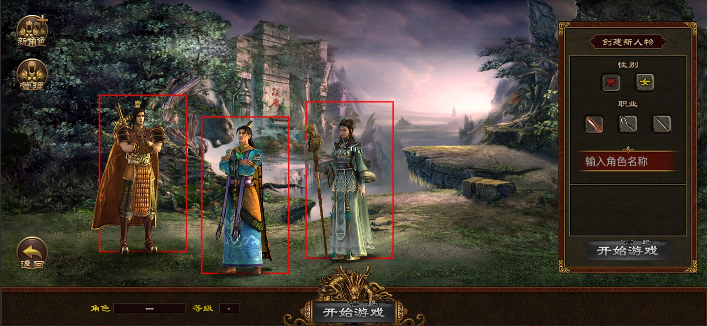
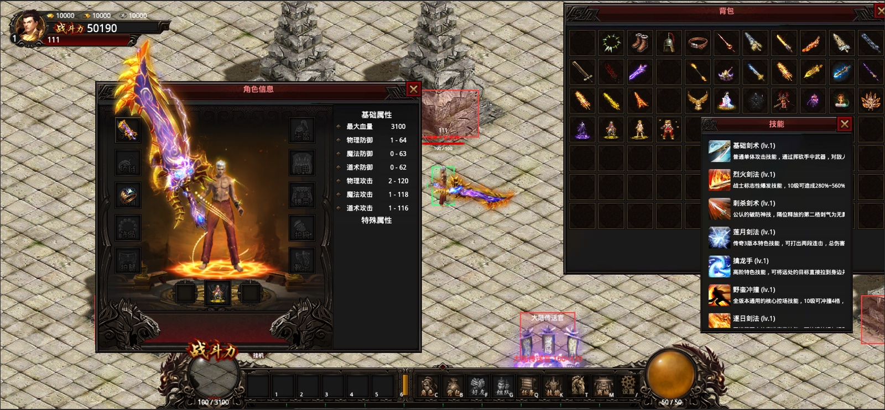
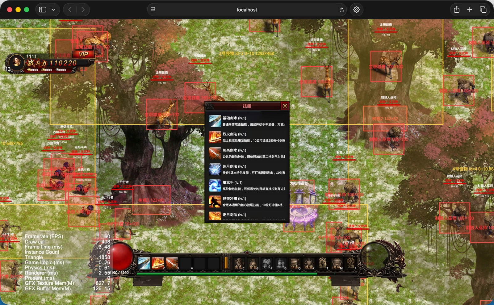
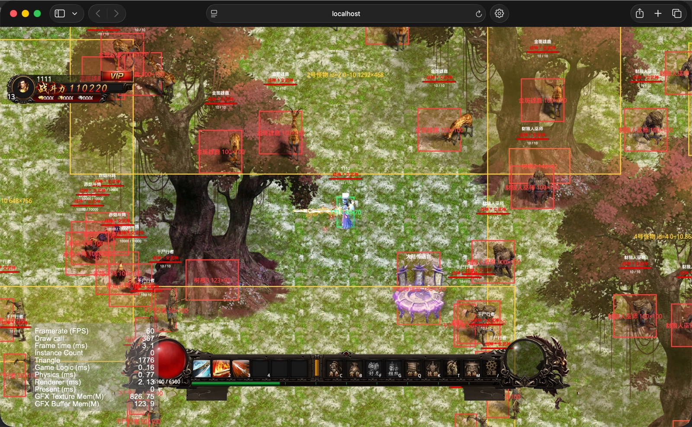
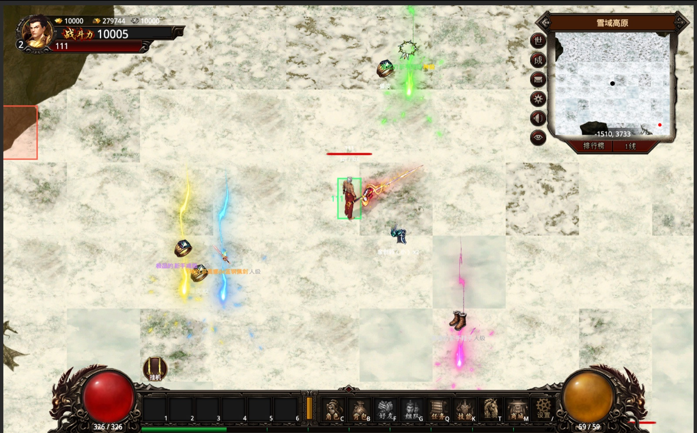
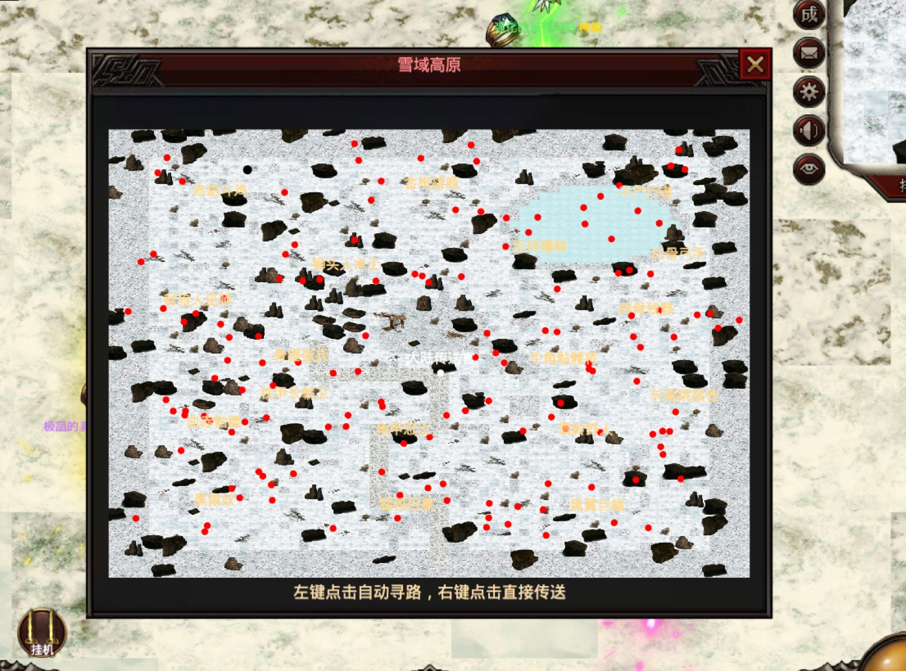
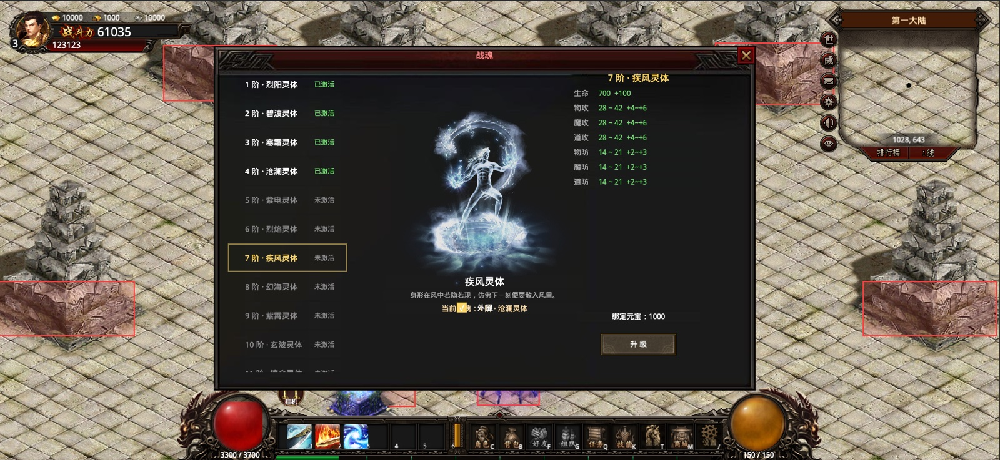
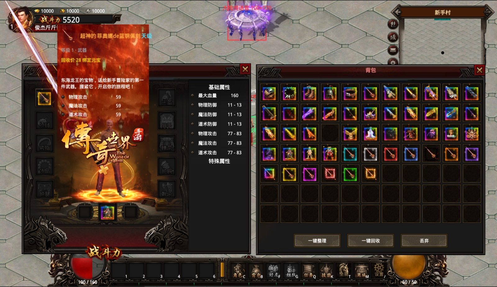
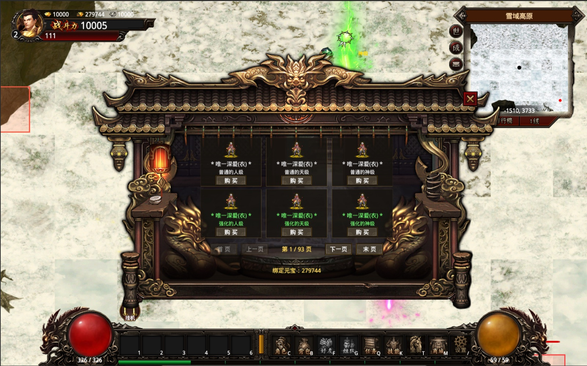

# olua

> [English](README.en.md) | 简体中文

> **本项目是一个纯 AI 编写的项目（Vibe Coding）：仓库里的每一行代码都是 AI 写的，没有一行是人手写的。**
> 人在这里只做两件事 —— **提需求、看效果**。具体怎么做的、留下了哪些痕迹，见 [一个纯 AI 编写的项目](#一个纯-ai-编写的项目)。
>
> **这不是一个可以直接上线运营的游戏项目** —— 它是几个不同背景（开发、AI）的人在一起学习研究的项目。

一个基于 Cocos Creator 3.8.7 的 2D 角色成长与装备玩法原型 + 配套的 NestJS 服务端与 React 管理后台，
聚焦登录、角色创建、角色成长、装备系统、地图探索与战斗玩法（打怪 / 掉落 / 技能 / 自动战斗）的完整三端演示。

## 代码在 GitHub：Gitee 只是同步镜像

本仓库的主仓在 **GitHub**（`github.com/WebCoderT/olua`），Gitee 上的 [putiwan/olua](https://gitee.com/putiwan/olua) 是它的**只读同步镜像**：

- **代码相关的一切操作都请前往 GitHub** —— 提 issue、发 PR、提交代码、看 commit 历史与 CI，都只在 GitHub 上进行；
- **Gitee 镜像**适合浏览代码、克隆 / 下载、顺手点个 Star；它是定期同步过来的，**有延迟，以 GitHub 为准**；
- 在 Gitee 上开的 issue / PR **不会被处理**（镜像不接收协作），请一律到 GitHub 提。

镜像实时数据（Gitee 官方徽章，随页面加载实时生成）：

[](https://gitee.com/putiwan/olua/stargazers)
[](https://gitee.com/putiwan/olua/members)

## 三个端

仓库按端分成三个**平级目录**，各自有独立的 README 与 FAQ；跨端的约定与机制放在本文件与根 [FAQ.md](FAQ.md)。

| 端 | 是什么 | 技术栈 | 目录 | 文档 |
| --- | --- | --- | --- | --- |
| **客户端** | Cocos Creator 游戏（登录 / 选角 / 战斗 / 背包 / 商城…） | Cocos Creator 3.8.7 + TypeScript | [`client/`](client/) | [README](client/README.md) · [FAQ](client/FAQ.md) |
| **服务端** | 账号 / 角色 / 管理接口，SQLite 落库，Swagger 文档 | NestJS 12 + `node:sqlite` + JWT | [`server/`](server/) | [README](server/README.md) · [FAQ](server/FAQ.md) |
| **管理端** | 运营后台（账号 / 角色 / 管理员 / 操作日志） | React 19 + Vite + Tailwind v4 | [`admin/`](admin/) | [README](admin/README.md) · [FAQ](admin/FAQ.md) |

三端的关系：**客户端**是玩家玩的游戏，**服务端**是它唯一的权威数据源（本地只是缓存），**管理端**给运营改数据。
接口契约由服务端单向生成到另外两端（见 [接口文件为什么是生成的](FAQ.md#接口文件路径--类型--方法为什么是生成的想加一个接口改哪)）。

```
client（Cocos）  ─┐
                  ├─→  server（NestJS + SQLite）  ←─  admin（React）
admin（React）   ─┘       ↑ 唯一手写接口的地方
                          └─ swagger:emit → openapi.json → gen-api → 两端接口文件
```

## 分支：master 横屏 / portrait 竖屏

仓库有两条长期分支，是**同一套代码的两种屏幕版本**（不是新旧关系，也别互相合并）：

| 分支 | 设计分辨率 | 是什么 |
| --- | --- | --- |
| `master` | 1624×750 | 主分支：竖屏改造之前的状态，之后的改动都从这条线走 |
| `portrait` | 750×1624 | 竖屏版本：按 `design/` 设计稿重排的登录与选角、每账号单角色、本机账号自动登录；竖屏那批提交都在这里，不再跟进 master |

- **切版本就是切分支**：`git checkout portrait` 看竖屏，`git checkout master` 看横屏；
- **差异范围**：`git diff --stat master portrait` —— 改动集中在 `client/`，服务端只有角色上限那一处；
- **素材不跟着分支走**：`client/assets/resources/`（美术包）与 `design/`（设计稿）都不进版本库，两条分支共用本机同一份。竖屏线的 `client/tools/gen-ui-assets.py` 会**原地改写** `login/login_bg.png` 与 `create_role/bg.png`（主视觉做成毛玻璃，脚本没留备份），所以从竖屏切回横屏时这两张要还原原图 —— 否则看到的是竖屏那版的修补效果，不是横屏的样子；
- **新克隆的仓库**先按 [快速开始](#快速开始) 放好素材，两条分支才都跑得起来。

## 项目简介

这个项目目前包含以下几部分：

- 登录场景、角色选择与创建场景
- 游戏场景主循环与地图切换（Loading 过渡场景，带进度显示）
- Tiled 地图渲染与对象组驱动：NPC 点位、复活点出生、矩形刷怪区、碰撞区
- 小地图（HUD）：底图用当前地图的 preview.jpg，按视野等比缩放并随角色平移，红点落在底图上的位置即怪物真实位置
- 路线指示线：自动寻路（点击寻路 / 快速攻击追怪 / 自动挂机）期间，大地图地面与右侧小地图同时画出「角色 → 目标」的白色点状路线，终点用更大的白圈标出目的地（同一处路径数据，终点随目标移动实时更新）
- 角色属性、等级与成长系统（HP / MP / 攻防区间 / 每秒回血 / 战斗力）
- 装备系统：穿脱、属性汇总、内外观（8 方向外观位置 / 缩放 / 旋转）、未穿衣服时**按性别显示默认身体**（男 role/1 / 女 role/2）、装备详情弹窗（三段式着色名称 / 等级 / 部位 / 属性区间）
- 装备前后缀变体：前缀（普通 / 强化 / 精良 / 极品 / 超神）× 后缀（人级 / 天级 / 神级）每件基础装备展开 15 个变体，属性按倍率逐项缩放，名称与文字按品质着色
- 装备品质边框与详情背景：背包格与身上装备图标按前后缀组合显示发光**边框动画**（resources/borders 84 张图集全登记），悬停详情弹窗按同一组合切换**背景动画**（resources/backgrounds 41 个帧序列目录全登记）；两者均取前 15 套按强度分配给 15 种组合，其余留给特殊装备的自定义表
- 战斗系统：技能触发统一入口、冷却（按动作速度折算）、魔法消耗、伤害飘字、击退、突进位移（十步一杀：鼠标落点瞬移 + 落点特效）
- 怪物系统：区域刷怪、AI 行为（待机游走 / 主动追击 / 受伤激怒追击 / 普攻）、死亡动画、信息面板、选中光圈
- 死亡与复活：怪物死亡倒地动画播完才消失；角色死亡停帧锁操控，弹窗选择原地复活 / 回复活点安全复活
- 经验与等级：击杀按角色与怪物等级差结算经验（差值越大越少，差 6 级以上无经验），升级属性重算并补满状态
- 掉落系统：按权重概率掉落、**掉落件数按每只怪配的区间随机**（如 `[1, 10]` = 本次掉 1~10 件，可重复命中同一物品）、掉落物同心环散落互不重叠、走上去自动拾取 / 点击拾取；**每只怪的掉落列表独立配置在 `configs/monsterDrops`（key 与怪物一一对应），条目逐条配权重 / 概率 / 数量**，555 件装备按等级分段铺满全部怪物
- 掉落光柱：装备落在地上时按前缀品质播放**光柱特效**（resources/effect/light 6 套全登记，前 5 套按普通→超神自动分配、第 6 套预留给特殊装备的自定义表）；地面掉落名按「前缀 + 名称 + 后缀」三段着色
- 商城系统：底部「商城」入口，**系统内全部装备（555 件含前后缀变体）自动上架**，默认 1 绑定元宝/件，购买直接进背包；门面式弹窗 + 卡片网格分页浏览（一行 3 张、每页 6 件），悬停图标看完整详情
- 背包操作：一键整理（合并同类可叠加物 + 按等级/部位重排，从第一格起铺满、空格沉底）、拖动物品换格（空格移动 / 同种合并 / 其余交换，拖物品不带动弹窗）、**拖出弹窗松手 = 整格销毁（全屏确认框：确定销毁 / 取消回原位）**、一键回收为绑定元宝、丢弃模式整格丢弃（不可恢复）；整理与移动规则均为纯函数、可单测
- 自动战斗：快速攻击与自动挂机开关，基于 A* 寻路绕障碍走位
- 状态（Buff）系统：技能附加状态、身上循环特效、头像下方图标条
- 悬停详情：鼠标放在状态图标上显示名称 / 介绍 / 剩余时间，放在技能格上显示技能名称 / 介绍 / 冷却等基础信息
- 战魂系统：37 阶成长线（外观取自 war-soul 素材），绑定元宝升级，属性计入战力与地图进入条件，可勾选外显到主角右上角；弹窗入口在角色信息弹窗「战魂」按钮（与「军衔」「称号」「时装」四格竖排相邻，NPC 战魂使者仍可用）
- 时装系统：**20 件时装**（外观与内观帧取自 resources/clothes，名称 / 描述 / 售价 / 属性在 fashions 表，管理端可改）；角色信息弹窗「时装」按钮打开衣柜，四列卡片点一下穿上、再点一下脱下，**只换外观不换数值** —— 属性、血量、战力仍由装备决定；地图上的主角、弹窗内观、进图预载三处同口径取源（时装 > 装备衣服 > 性别默认外观），穿时装不会把角色挪位（几何仍按装备那件）；本版是衣柜口径，获取渠道（商城 / 活动 / 掉落）另开一刀
- 称号系统：34 个带字名牌动画（resources/titles 全登记）排成 1~34 阶成长线，解锁/升级流程与战魂一致（绑定元宝价格曲线），属性按曲线生成；解锁后名牌常显在角色头顶信息栏（与军衔红字/血条同一节点），弹窗入口在角色信息弹窗「称号」按钮（不走 NPC）
- 军衔系统：**100 阶**成长线（10 大段 × 10 阶：兵卒 → 校尉 → 都尉 → 中郎将 → 将军 → 重号将军 → 公卿 → 王爵 → 神将 → 神话），绑定元宝晋升，属性按「等效等级裸属性 × rate × 大段 factor」生成（夹在称号与战魂之间）；军衔**没有素材**，它的外观就是角色头顶信息栏血条上方那行**红字**，晋升后立即更新；弹窗入口在角色信息弹窗「军衔」按钮（四格中自上数第二格），左栏 100 阶列表只在打开时建一次、切换选中不重建
- 每秒血量回复：**等级 / 防御装备 / 战魂 / 称号 / 军衔** 五处来源相加成一项属性（每秒 N 点），游戏主循环每秒结算一次并落盘（与回蓝共用同一次写档）；强度**按最大生命比例派生**（默认每秒回 1%，整体调速只改 `configs/growth.attributeRange.hpRecoverRate` 一个数）；**只有防御部位装备带回血**（衣 40% / 头 20% / 腰带 20% / 鞋 20%）；死亡期间不回复、回血**不计入战斗力**（不会抬高任何地图的战力门槛）、怪物不回血；旧存档自动补字段
- 头顶显示口径：**角色名称显示在人物区域正中间**（与怪物名称同一套「身体中心」口径，位置随 roleBody 高度自动居中）；头顶信息栏只留军衔红字 / 血条 / 血量文字，称号名牌动画插在最上方
- 弹窗层级：同屏打开多个弹窗时，**点哪个哪个浮到其它弹窗之上**（触摸与鼠标两条输入通道都接管；飘字提示、悬停物品详情这类临时层仍在弹窗之上，全屏确认框与死亡遮罩保持盖住弹窗）
- 地图传送：传送官弹窗按地图类型分类展示，等级/战力/战魂未达标的地图点击时提示
- 小地图弹窗：读取地图目录 preview.jpg 大图预览，左键点击自动寻路、右键点击直接传送
- 资源预加载：进图前预载地图、NPC / 怪物帧动画与角色穿戴外观
- 操作摇杆：左下角常驻摇杆（底座 + 可拖动手柄），按住拖动即移动 —— **拖得少走路、拖得多跑动**（死区/阈值见 configs/role.joystickMove）；只用触摸通道，桌面端鼠标按住拖动同样可用，摇杆上的按压不穿透、拖动结束也不会误清选中目标
- 屏幕适配：铺满窗口（NO_BORDER）不留黑边，常驻 HUD 按可见区贴边重排；选角场景整块舞台等比缩放（contain），窗口宽高比与设计不一致时元素也不会跑到屏幕外
- 服务端：账号注册登录（scrypt 加盐摘要）、角色数据云端保存（防抖合并推送）、修订号乐观锁、两套令牌受众、权限点守卫、登录限流、口令重置与令牌主动作废、操作审计日志、公告发布与全服触达、邮件通道（模板 + 投递队列 + 失败重试）、实时通道（一次性票据换 WebSocket 连接、心跳与存活探测、一账号一条连接）、**伤害结算上移**（服务端按共享快照数值算打怪伤害、castId 幂等、死亡判定，客户端只做表现）、**世界权威**（怪物实例服务端持有：进图播种 / 跨账号共享 / tick 到点重生 / 状态落盘跨重启恢复，客户端只做表现与差量合并）
- 管理端：账号与角色管理（六维筛选 / 结构化编辑 / 批量删除）、管理员与权限、操作日志查询、我的账号；角色详情页把装备 / 技能 / 物品 / 地图 / 战魂称号军衔都**显示成名字**（名字来自三端共用的那份游戏数据，后台不自己维护一份）
- **游戏数据只有一份**：装备 / 战魂 / 称号 / 军衔 / 技能 / 物品 / 地图的权威定义都在客户端 `client/assets/configs`，由 `tools/gen-shared-data.cjs` 快照成 `server/src/shared/game-data.generated.ts` —— 服务端与管理端读的是**同一个文件**（`tools/audit-shared-data.cjs` 守着它逐字节不漂、每张表齐全非空，并禁止任何一端再抄一份：同名的表、手写的码清单、抄来的中文名都会被拦）。连服务端校验用的「职业 / 性别码清单」与接口文档里那行 `1 战士 / 2 魔法师 / …` 也是从这份数据**算出来**的，客户端加一个职业码三端自动跟着变。

## 一个纯 AI 编写的项目

**这个仓库里的每一行代码都是 AI 写的。** 客户端（Cocos Creator）、服务端（NestJS）、管理端（React），
以及 `client/tools/` 与 `tools/` 下的全部单测与审计脚本、`README.md` / `FAQ.md` 这些文档 —— 没有一行出自人手。

这是一个 **Vibe Coding** 项目：人不写代码，人只**用自然语言提需求、跑起来看效果、说哪里不对**，剩下的全部交给 AI。

### 人和 AI 各自干了什么

|            | 人                                | AI                                                     |
| ---------- | -------------------------------- | ------------------------------------------------------ |
| 负责什么       | 提需求（「加个军衔系统」「后台要能改角色属性」）、看效果、指出哪里不对、在几个方案里拍板 | 读现有代码 → 设计方案 → 写实现 → 写单测与审计脚本 → 自查回归 → 同步文档 → **按功能提交** |
| 不负责什么      | **不写代码**、不查 API 文档、不手工调格式        | **不拍板** —— 拿不准的方案会先把选项摆出来问       |

### 这套做法留在仓库里的痕迹

- **每个踩过的坑都会变成一个脚本**。这里不靠记性防回归，靠自动化守卫：`client/tools/` 下有 54 套单测、`tools/` 下有 12 套审计，比业务代码还密 —— 配置有没有外泄、接口地址有没有硬编码、生成物与服务端文档是否逐字节一致、战斗规则快照有没有漂移、服务端算的属性与客户端是不是同一份、界面点击会不会穿透到世界、模块边界有没有被绕过，全都有脚本盯着。
- **一切可调的东西都收进 `client/assets/configs`**。数值、文案、布局、配色、时长、资源路径都不写进逻辑里。这条约定是被「AI 反复改数值」逼出来的，不是为了好看。
- **接口文件全部由服务端 Swagger 文档生成**。三端签名对不上会**编译报错**，而不是线上出现一个 `undefined`。这同样是为了让 AI 改完一端后，另一端在编译期就被拦住。
- **回归是硬门槛**。每次改动都要跑：服务端 e2e（248 + 120 + 283 + 120 + 28 + 50 + 130 + 24 + 14 + 639 + 87 + 32 + 60 + 47 + 35 + 48 + 24 + 50  + 79 + 55 + 39 + 51 条）+ 两端类型检查 + 54 套单测 + 12 套审计，全绿才算完。
- **每处理完一个问题就按功能提交一次**。改完一个功能立刻落一次 commit，不留一堆混在一起的未提交改动 —— 这样「哪次改动引入了回归」永远能二分出来。
- **踩过的坑写进了 FAQ**。每端目录下的 FAQ 收纳该端的具体问题，跨端的机制与环境坑在 [FAQ.md](FAQ.md)；里面的每一条都是真实撞过的，包括环境坑（例如某类终端注入的 `NODE_OPTIONS` 会让服务端**静默起不来**）。

### 期望管理

代码经过了完整回归、能跑通，但请把它当成**一件 AI 的作品**来看：结构上的取舍以「先跑起来再收敛」为主，
有些抽象（配置与逻辑分离、生成物 + 守卫、纯函数 + 单测）是**为了让 AI 后续能安全改动**而专门设计的，不一定是人类手写代码时的第一选择。

如果你想知道 AI 到底能把一个项目做到什么程度 —— 下面这份「功能清单」就是答案。欢迎 review、提 issue、拍砖。

## 游戏截图

**登录**


**角色选择与创建**



**游戏主界面（角色信息 / 背包 / 技能弹窗）**



**技能列表**



**怪物与战斗**



**装备掉落光柱（地面掉落物按前缀品质播放光柱特效：普通→超神 5 档自动分配，第 6 套预留给特殊装备）**



**小地图预览弹窗（大图预览 + 怪物红点 / NPC / 刷怪区；左键点击自动寻路、右键直接传送）**



**战魂系统**



**装备品质边框与详情背景（背包 15 种前后缀品质边框；悬停详情弹窗显示按品质切换的背景动画）**



**商城（系统内全部装备上架，一行 3 张卡片、每页 6 件分页浏览；悬停图标看完整详情）**



## 目录结构

```
olua/
├── README.md · FAQ.md      # 总览与跨端问题（本文件）
├── client/                 # 客户端：Cocos Creator 工程（用它打开这个目录）
├── server/                 # 服务端：NestJS
├── admin/                  # 管理端：React
├── tools/                  # 项目级脚本（跨端）
├── website/                # 项目官网（纯静态单页）
├── docs/                   # 项目文档（简历介绍等）
└── equip-aligner/          # 装备素材偏移对齐小工具
```

### client —— 客户端（Cocos Creator 工程）

> 约定：**核心代码只做「怎么跑」，一切可调的东西都在 `assets/configs`** ——
> 数值、文案、布局、配色、时长、资源路径都不写在逻辑里。
> 自查：`node tools/audit-config-leak.cjs`（在仓库根跑；扫出散落在 ui/ 里的可配置项与未登记的文案 key）。

> **下列路径均相对 `client/`**（即 `assets/configs` 的完整路径是 `client/assets/configs`）。

- assets/configs：数值与静态配置（按域一文件：role/monster/skill/equipments/items/drop/map/status/border/background/title/light/mall 等）
  - configs/texts：**面向玩家的全部文案**（浮动提示 / 校验原因 / 界面标签 / 悬停详情 / 加载进度，带 `{占位符}` 模板）
  - configs/bottomNav：底部功能入口表（名称 / 图标 / 解锁等级 / 快捷键）
  - configs/network：**客户端唯一的服务端地址来源**（根地址 / 超时 / 重试 / 角色进度同步防抖间隔）
  - configs/layout：UI 布局与样式（hud / dialogs / panels / scenes / borders / backgrounds / lights / images / sizes / theme）
- assets/types：纯类型声明（common/role/animation/good/skill/map/monster/drop/status/border/background/title/light）
- assets/entities：运行时实体（Role）
- assets/skills：技能行为实现（技能实现只依赖 SkillContext，不反查全局）
- assets/ui：界面脚本
  - ui/core：静态管理器（GameHelper/LayerManager/MonsterManager/MonsterAI/DropManager/SkillManager/StatusManager/EffectManager/AutoBattle/PreloadManager/StorageManager/RoleUIManager/SceneManager 等）
  - ui/components：按职责分组（hud/panel/dialogs/role/input/map）
  - ui/helpers：UI 生成（UiHelper 基础封装 / GameUiHelper 零件库 / AnimationHelper 帧动画）
  - ui/utils：纯函数工具，按功能域分目录（battle/drop/map/physics/resource/input/cursor/layout/node）
  - ui/utils/net：**对服务端的全部访问**
    - 生成物（禁止手改）：`ApiRoutes` 路径表 / `ApiModels` 类型（服务端 DTO 的镜像）/ `Api` 接口方法（`HealthApi`·`AuthApi`·`AnnouncementApi`·`RoleApi`·`RealtimeApi`）
    - 手写：`HttpClient` 二次封装与统一调度 / `ApiCodes` 业务码与文案 key / `ApiError` 错误归一 / `Session` 会话 / `RoleSync` 进度同步 / `NetworkSetup` 接线
- assets/resources：资源目录（地图 tmx、帧动画、图集、图标、UI 素材）
- assets/scenes：登录、角色选择、加载和游戏场景
- tools：**客户端专属脚本**（54 套单测 + `gen-monster-config.cjs` / `gen-monster-drops.cjs` 配置生成器 + `clean-role-empty-frames.cjs` 素材清理 + `lib/` 单测沙箱）
- settings / profiles / native / package.json / tsconfig.json：Cocos 工程配置（`package.json` 是 Cocos 的工程描述，不是 npm 脚本）
- library / temp / build：Cocos 缓存与构建产物（不进版本库）
- 详见 [client/README.md](client/README.md)，问题见 [client/FAQ.md](client/FAQ.md)

### server —— 服务端（NestJS）

- src/common：统一响应包裹、业务码、守卫（认证 AuthGuard / 权限 PermissionGuard）、过滤器、拦截器、装饰器
  - constants/permission：**权限点与管理员角色的唯一来源**（角色 → 权限映射；文档上的「所需权限」由它反查生成）
  - constants/swagger-tags：文档分组（公共接口 / 客户端 / 管理端）
  - interceptors/audit.interceptor：**管理端写接口自动记日志**（动作取 `operationId`，口令类字段落库前打码）
  - security：登录限流的纯函数判定（`rate-limit.util`）+ 内存计数器服务（`login-throttle.service`）
- src/database：SQLite 连接与 43 张表（accounts / roles / admins / audit_logs / announcements / mail_queue / world_monsters / map_spawn_areas / zones / world_meta / titles / souls / ranks / equipments / drugs / items / monsters / npcs / fashions / mall_prices / mall_settings / drop_tables / monster_drops / level_exps / growth_segments / growth_scalars / skills / statuses / monster_skills / guilds / guild_members / guild_applications / role_friends / role_enemies / role_blocks / role_reports / quests / quest_progress / parties / party_members / achievements / role_achievements，含存量补列）的仓储层
- src/modules：auth（玩家认证）/ roles（角色）/ admin（管理端：认证 / 账号 / 角色 / 管理员 / 口令）/ announcement（公告：公共拉取 + 管理端 CRUD）/ mail（邮件：模板 + 投递队列 + 后台调度）/ audit（操作日志）/ token（JWT）/ health
- src/swagger/setup：文档挂载（抽成函数，好让自动化测试也生成一次文档来验分组 / 权限标注 / 悬空 `$ref`）
- src/swagger/emit：**离线产出 `openapi.json`**（`npm run swagger:emit`，两端接口文件的唯一输入）
- openapi.json：机器可读契约（提交进仓库；改接口后必须重新生成，否则两端停在旧契约上）
- test/e2e.cjs：端到端用例（真实起服务 + 真实请求，248 条断言：注册登录 / 角色 CRUD / 越权 / 令牌受众隔离 / 管理端全流程 / 文档分组与权限点 / 四级越权与超管保护 / 公告拉取与时间窗）
- test/e2e-roles.cjs：**角色管理专项**（120 条断言：修订号乐观锁 + 引导进度结构校验 / 六维筛选 / 结构化字段校验 / 批量与整账号删除 / 只读观察员越权 / 文档）
- test/e2e-guard.cjs：**运营与安全底座专项**（283 条断言：口令重置与令牌作废 / 自助改密 / 操作日志落库·打码·筛选·权限 / 按用户名与按 IP 的登录限流 / 踢下线）
- test/e2e-mail.cjs：**邮件通道专项**（120 条断言：用可注入的**假发信器**验入队 / 投递 / 重试与用尽上限 / 手动重投 / 未配置 SMTP 时整体禁用；不需要真实 SMTP 服务器）
- test/e2e-account-email.cjs：**玩家邮箱字段专项**（28 条断言：观察员看不到也改不了 / 补录·清空 / 格式与同邮去重 / 发信按账号邮箱兜底）
- test/e2e-game-config.cjs：**养成配置专项**（44 条断言：称号 / 战魂 seed 与客户端配置同源 / 只许改不许增删（POST、DELETE 404）/ 部分更新与渠道筛选 / 观察员可读不可写）
- test/e2e-blocks.cjs：**屏蔽与举报专项**（50 条断言：拉黑单向一行与重复·自拉黑挡回 / 聊天广播逐收件人剔除与私聊两个方向两种说法 / 互见增量与 full 快照都过滤 / 解除后重发进图 / 拉黑剪好友与敌人 / 举报去重与非法类别 / 管理端只读列表与越权）
- test/e2e-party.cjs：**队伍专项**（79 条断言：邀请即建队 / 同意与拒绝 / 满员与重复邀请 / 踢人转让与权限翻转 / 队长退出自动移交 / 解散三端清空 / 屏蔽优先（两种说法）/ 互见帧带 partyId / 经验分成（击杀者全额·同图队友 50%·异图与等级差过大分不到）/ 上限脏值回落）
- test/e2e-rank.cjs：**排行榜专项**（55 条断言：三个榜的名次与数值逐条对 / 并列时同名次（竞赛排名）/ 战力榜与等级榜不同序（不是照抄等级）/ 分页切片、空页与 size 夹上限 / `me` 榜内榜外名次都真实、没有活跃角色时返回「没有名次」/ 刷新周期设为零时快照不随存档变 / 条目恰好八项且不带 accountId·data·在线状态 / 周期定时重算真的换了一份）
- test/e2e-achievement.cjs：**成就专项**（39 条断言：快照下发与条件展开 / 累计型（击杀任意怪与指定怪、交付任务）事件记账 / 状态型（等级·战力·背包）**不落进度、查询现算** / 领取发奖一次落库、重复领与未达成各自 50133·50132 / 背包满 **整份奖励转邮件**且照常记已领（状态型第一次领奖就把行建出来，不可能反复刷）/ 管理端改配置与「有记录拒删」/ 生成期引用校验）
- test/e2e-game-mail.cjs：**游戏内邮件专项**（51 条断言：收件箱与未读·未领两口径 / 重复标已读不改写第一次时刻 / 领取金币·经验·物品一次落库、重复领 50142、不存在 50141、无附件邮件不碰存档 / 附件没领不能删 50143 / 一键领取领到背包满为止 / 成就领奖背包满 → 转邮件 → 清包后从邮箱领到手 / **频道**：四条角标固定出现、按栏领取只动那一栏、非法频道 40000、好友申请落「社交」、打死 boss 落「战斗」而普通怪不落）
- test/backup.cjs：**备份 / 恢复专项**（87 条断言：运行中 `VACUUM INTO` 一致快照 / 恢复留档 / 保护性拒绝 / 自动定时备份）
- 详见 [server/README.md](server/README.md)，问题见 [server/FAQ.md](server/FAQ.md)

### admin —— 管理端（React）

- src/api：地址配置（唯一来源 `config.ts`）+ 请求层 `http.ts`（拦截器 / 超时 / 包裹解包 / 错误归一 / 401 跳登录）
  + **生成物** `routes.ts` 路径表 / `models.ts` 类型 / `endpoints.ts` 接口方法（`authApi`·`rolesApi`·`questsApi`·`achievementsApi` 等，一个接口一个方法，页面只 import 名字）
  + 手写的 `types.ts`（业务码 / 权限点 / 动作与目标的中文字典）与 `index.ts`（统一出口）
- src/pages：登录 / 注册 / 概览 / 账号列表与详情（重置密码 · 踢下线 · 清空该账号全部角色）/ 角色列表（筛选 + 多选批量删除）与详情（基础信息 / 常用数值 / 装备·技能·背包结构化编辑）/ 管理员（改角色 · 启停 · 重置密码 · 删除）/ 公告（发布 · 编辑 · 删除 · 启停 + 生效状态列）/ 邮件（发信入队 + 投递记录：状态筛选 · 重试次数 · 失败原因 · 重投）/ 操作日志（筛选 + 分页 + 请求体展开）/ 玩家举报（筛选 · 分页 · 行展开证据，只读）/ 我的账号（自助改密）
- 界面按令牌里的**权限点**显隐菜单与按钮（`store/session.hasPermission`），服务端仍独立校验
- 详见 [admin/README.md](admin/README.md)，问题见 [admin/FAQ.md](admin/FAQ.md)

### tools —— 项目级脚本（跨端）

- gen-api.cjs：**由 `server/openapi.json` 产出两端接口文件**（唯一的代码生成器，服务端 `npm run gen:api` 调它）
- gen-shared-data.cjs：**由 `client/assets/configs` 产出三端共用的公共游戏数据**（`server/src/shared/game-data.generated.ts`，管理端 import 的是**同一个文件**）—— 战斗数值（等级 60 / 战魂 37 / 称号 34 / 军衔 100 + 战斗力权重 7 项 + 装备 555 件已展开前后缀变体 + 技能 12 个含各等级伤害系数 + **怪物 220 只的 maxHp 与攻防六项区间**）**加上**名字与元数据（职业 3 / 物品 566 / 槽位 13 / 装备显示名 555 / 技能名 12 / 地图名 11 / 战魂与称号与军衔各级名）。想改数值或文案就改客户端配置，然后重新生成 —— 三端**没有**第二份副本
- audit-api-generated.cjs：生成物与文档逐字节一致 / 头标记 / 接口全覆盖 / 类型不悬空 / 路径只在路径表 / Cocos `.meta` 齐全
- audit-api-hardcode.cjs：三端有没有硬编码地址、请求是否只在唯一出口发出、环境变量键是否都登记进 `.env.example`
- audit-config-leak.cjs：客户端核心代码有没有可配置项外泄 + `configs/texts` 的 key 是否都被登记（白名单 `config-leak-allowlist.json`）
- audit-ui-click-through.cjs：客户端 UI 点击会不会穿透到世界、按压归属的接线是否齐全
- audit-shared-data.cjs：公共游戏数据与客户端 `configs` 是否逐字节一致，外加「每张表都在且非空」（**数据**漂移不会报错，只会让两端慢慢算得不一样）；另守一条跨端数值约定 —— 角色数量上限不得超过选角界面的站位数量（客户端那边没有第二个上限数字）
- audit-combat-parity.cjs：服务端算的角色属性是否与客户端 `combatCalc` 一致（**算法**漂移）。期望值不是抄一份口径，而是把真的 `GameHelper.combatCalc` 编译进 Node 跑一遍 —— 2849 组输入 × 10 项，覆盖全等级 / 全装备 / 全战魂称号军衔
- audit-deploy.cjs：Docker / compose / nginx 的跨文件接线是否对得上
- audit-docs-en.cjs：英文文档译本是否与中文版走散（覆盖 / 残留中文 / 章节等价 / 数字不丢 / 锚点与链接可达 / 互链）
- audit-doc-numbers.cjs：文档里「几个接口 / 几条路径 / 几个模型 / 几个权限点 / 几张表 / 多少条 e2e」这类数字是否与实测一致（这类数字漂了**不会报错**，只会让文档自信地写着过期的数；各端 README 与**项目技能**都在受管清单里）

### 其它

- website：项目官网（纯静态单页：核心特色 / 截图画廊 / 三端架构 / 工程化 / 联系方式，logo 与 favicon 在 website/assets/icons，群二维码在 website/assets/img）
- docs：项目文档（`resume.md` 等）
- equip-aligner：装备素材偏移对齐小工具（自带 README 与自检脚本）

## 技术栈

- Cocos Creator 3.8.7
- TypeScript
- Cocos UI / 2D 场景系统 / Box2D 物理（刚体与碰撞体）
- 服务端：NestJS 12 + `node:sqlite`（Node 22 内置，无原生模块依赖）+ JWT（玩家 / 管理端两套受众）+ Swagger
- 管理端：React 19 + TypeScript + Vite + Tailwind CSS v4
- 开发方式：**全部由 AI 编写（Vibe Coding）**，人类只提需求与验收 —— 见 [一个纯 AI 编写的项目](#一个纯-ai-编写的项目)

### 存储与多进程：SQLite WAL（#37 的决策）

存储选 **SQLite WAL 单库共享**，不上 Postgres：单机部署 + 写入天然低频（玩家存档走节流、世界状态 5 秒批量落盘），文件库开 `journal_mode = WAL` + `busy_timeout` 后多进程「各写各的表」的低频并发完全够用；换库要多养一个数据库容器、改 SQL 方言、迁移数据，收益配不上成本。真到了多台服务器 / 写 QPS 明显上涨时再换——仓储层（SQL 全收在 `repositories/` 下）是唯一要动的一层。完整理由见 [FAQ](FAQ.md#为什么选-sqlite而不是-postgres多进程怎么共享它)；服务端拆多进程的设计见 issue #175 / #176。

## 常用命令（Makefile）

仓库根有一份 Makefile，把三端的常用动作收在一处（`make` / `make help` 列出全部，`make info` 打印当前工具链与关键路径）：

```bash
make install        # 首次：装 server / admin 的依赖
make env            # 生成 server/.env（已存在则跳过）
make dev            # 同时起服务端 :3100 与管理端 :5173，Ctrl-C 一起退出

make client-check   # 客户端类型检查（Cocos 自带 tsc，0 错才算过）
make client-test    # 客户端 54 套单测
make server-verify  # 服务端一条命令全验（编译 + 二十二套 e2e + 生成物审计）
make admin-build    # 管理端类型检查 + 构建
make gen-api        # 改完接口后重新生成契约与两端接口文件
make audit          # 12 个跨端审计脚本

make check          # 静态检查：客户端 tsc + 管理端 typecheck + 12 个审计
make test           # 全部测试：客户端 50 套 + 服务端二十二套 e2e
make verify         # 完整门禁：check + 三端构建 + 全部测试（提交前跑这个）
```

- 单跑一套客户端单测：`make client-test-one T=test-bag-tidy`
- 换机器 / 换 Cocos 版本：`make TSC=/path/to/tsc client-check`
- 客户端生成器与清理器：`make client-gen-monster` / `make client-clean-frames`（预演）/ `make client-clean-frames-apply`
- 受限终端（被注入了 `NODE_OPTIONS`）**不用特殊处理** —— Makefile 已统一清掉；想用原始环境：`make RUN_ENV= <目标>`

下面是各端的手工命令，不依赖 `make` 也能跑。三端的详细说明与全部环境变量见各自的 README。

## 快速开始

三端的详细说明与全部环境变量见各自的 README；这里是「最短跑通路径」。

### 1. 服务端（先跑起来，客户端与管理端都依赖它）

```bash
cd server
npm install
cp .env.example .env     # 首次：端口 / 密钥 / 上限都在这里；注释里逐项说明
npm run dev              # 开发（热编译）；或 npm run start 跑已构建产物
```

- 接口文档（Swagger）：<http://localhost:3100/api-docs>（JSON 在 `/api-docs-json`）
- 健康检查：<http://localhost:3100/api/health>
- 一条命令全验：`npm run verify`（编译 + 二十二套 e2e + 生成物一致性）
- 详见 [server/README.md](server/README.md)

### 2. 客户端（Cocos）

1. 安装并打开 Cocos Creator 3.8.7。
2. 通过 Creator 的 “Open” / “Open Project” 打开 **`client/`** 目录（它才是 Cocos 工程根）。
3. 在编辑器中打开 `client/assets/scenes` 下的场景文件。
4. 使用预览或播放按钮运行项目。

客户端没有 npm 脚本，依赖 Cocos Creator 编辑器启动与预览。
连哪个服务端只由 `client/assets/configs/network.ts` 的 `baseUrl` 决定（真机调试改成局域网 IP）。
详见 [client/README.md](client/README.md)。

### 3. 管理端（React）

```bash
cd admin
npm install
cp .env.example .env.development   # 首次：接口根地址在这里（VITE_API_BASE_URL）
npm run dev                        # 开发；npm run build 产出 dist
```

管理端注册需要在 `server/.env` 里配 `ADMIN_REGISTER_CODE`（留空则开放注册），注册时填同一个注册码。
**第一个**注册的管理员自动成为超级管理员（全部权限），之后的都是普通管理员，要提权由超管在「管理员」页调整。
详见 [admin/README.md](admin/README.md)。

### 4. 改接口 = 改服务端 + 重新生成

客户端与管理端**不手写任何接口文件**：接口路径、方法名、请求/响应类型全部从服务端的 Swagger 文档产出。
这样「服务端改一个字段、另外两端忘了改」这类问题会变成**编译报错**，而不是线上出现一个 `undefined`。

```bash
cd server && npm run gen:api     # = swagger:emit + node ../tools/gen-api.cjs
```

```
server/src（控制器 + DTO + 装饰器）           ← 唯一需要手写的地方
        │  cd server && npm run swagger:emit
        ▼
server/openapi.json（机器可读契约，提交进仓库）
        │  node tools/gen-api.cjs
        ▼
客户端 client/assets/ui/utils/net/{ApiRoutes,ApiModels,Api}.ts
管理端 admin/src/api/{routes,models,endpoints}.ts
```

**改接口的标准动作**：

1. 改服务端的控制器 / DTO / 装饰器（每个接口必须有 `operationId`，形如 `role.save`）；
2. `npm run gen:api` 重新产出文档与两端接口文件；
3. 两端 `tsc` / `npm run build` —— 有签名不兼容的地方会直接报出来（调用点按报错改）。

生成器认文档里的这几个字段（约定都写进文档，不靠猜）：

| 文档里的字段 | 由谁写 | 决定什么 |
|---|---|---|
| `operationId`（`<模块>.<方法>`） | `@ApiPublicDoc` / `@ApiPlayerDoc` / `@ApiAdminDoc` 的 `operationId` | 生成到哪个模块的哪个方法 |
| `x-olua-audience` | 同上（装饰器自动加） | 是否带令牌（`public` → `auth: false`） |
| `x-olua-data-schema` / `x-olua-data-nullable` | `@ApiDataResponse(...)` | 响应里 `data` 的类型（缺省 = `null`） |
| `x-olua-query-schema` | `@ApiQueryModel(XxxQueryDto)` | query 参数对应的命名类型 |
| `x-olua-permissions` | `@ApiAdminDoc({ permissions })` | 生成物注释里的「所需权限」（方便两端对照） |

**生成物禁止手改**，`tools/audit-api-generated.cjs` 会逐条盯着。
契约管线的完整说明见 [FAQ.md](FAQ.md#接口文件路径--类型--方法为什么是生成的想加一个接口改哪)。

### 5. 回归门槛

改动合并前至少跑完这三类（全绿才算完）。装了 `make` 的话就是一条命令：

```bash
make verify   # = check + 三端构建 + 全部测试
```

手工跑（等价，不依赖 `make`）：

```bash
# 客户端：54 套单测（在 client/ 下跑，脚本自己找 Cocos 自带的 tsc）
cd client && for t in tools/test-*.cjs; do node "$t" || exit 1; done

# 服务端：编译 + 二十二套 e2e（248 / 120 / 283 / 120 / 28 / 50 / 130 / 24 / 14 / 639 / 87 / 32 + 60 + 47 + 35 + 48 + 24 + 50  + 79 + 55 + 39 + 51）+ 生成物一致性
cd server && npm run verify

# 管理端：类型检查 + 构建
cd admin && npm run build

# 项目级审计（在仓库根跑）
node tools/audit-api-generated.cjs && node tools/audit-api-hardcode.cjs \
  && node tools/audit-config-leak.cjs && node tools/audit-ui-click-through.cjs
```

> 在受限环境（例如注入了 `NODE_OPTIONS` 的终端）里跑服务端子进程需要清掉它：`env -u NODE_OPTIONS npm run dev`。详见 [FAQ.md](FAQ.md)。

### 6. 资源同步（resources 不入库，多人怎么保持一致）

`client/assets/resources/` 体积大（素材原文件），**有意不进版本库**（见 `.gitignore`）。多人/多机并行开发靠「清单锁 + GitHub Release 分发」保持一致：

- **清单**：`resources.manifest.json` 提交进仓库，记录每个资源文件的 sha1 + 大小（含 `.meta`——Cocos uuid 绑在 meta 上，meta 必须随包分发，各机自生成会 uuid 漂移、prefab 引用断裂）。
- **分发**：分卷 zip 挂在 GitHub Release（tag = `resources-<版本号>`），单卷上限 1900MB（Release 单资产上限 2GiB，留余量自动续卷）。

日常动作：

```bash
make resources-verify                      # 拉代码后先跑：本地资源 vs 清单，不一致会列出缺失/多出/不一致
make resources-download VERSION=<v>        # 不一致或新机器：从 Release 下载分卷、解压、自动校验
```

改动资源后的发布动作（谁改资源谁发布）：

```bash
make resources-manifest VERSION=<v>        # 重新生成清单（版本号写到清单里，随代码提交）
make resources-pack VERSION=<v>            # 打分卷 zip 到 resources_dist/<v>/
make resources-upload VERSION=<v>          # 上传到 GitHub Release（需 gh 已登录）
```

约定：**先合并带新清单的 PR，再跑 upload**（别人拉到新清单后 `resources-verify` 会亮红，此时 `make resources-download VERSION=<v>` 即可对齐）。工具本体是 `client/tools/resources_sync.py`。

## 功能清单

> ✅ 已完成　❌ 未完成　　服务端与管理端的细粒度能力见各自 README。

### 账号与角色

| 功能           | 说明                                |  状态 |
| ------------ | --------------------------------- | :-: |
| 账号注册 / 登录     | 账号存服务端（SQLite），口令 scrypt 加盐摘要；令牌 7 天有效，登录失败不区分「账号不存在」与「密码错误」 |  ✅  |
| 角色选择与创建      | 每个账号最多 3 个角色，列表与数据都存服务端；创建的新角色按客户端配置生成（新手装备/背包/快捷键） |  ✅  |
| 游戏进度云端保存     | 角色改动（打怪升级 / 拾取 / 买卖 / 换装 / 吃药）自动写回服务端，**防抖 1.5 秒合并**，切地图与退出前立即补推 |  ✅  |
| 旧存档自动迁移      | 新增字段/存储格式变更时读取自动补齐（装备/背包 id 引用制等） |  ✅  |
| 删除角色         | 选角界面「管理」进入管理态，各角色头顶出现删除按钮，两步确认后由服务端删除（不可恢复） |  ✅  |
| 新角色出生背包     | 通用件 + 全部基础武器/衣服，外加 **1 级武器的全部前后缀变体（15 件品质）** 一起发进背包，出生即可对比外观与边框 |  ✅  |
| 管理端（React）    | 管理员登录注册、账号分页检索与封禁、查看账号下的每个角色并改属性 / 切换在线 / 删除、**重置玩家口令**、**踢下线** → [admin/README.md](admin/README.md) |  ✅  |
| 后台角色管理        | 六维筛选（关键字 / 在线状态 / 职业 / 性别 / 等级区间 / 账号）；**全部基础信息可改**（名称 / 职业 / 性别 / 等级 / 时装 / 头像 / 所在地图 + 金币 / 元宝 / 银两 / 经验 / 战魂 / 称号 / 军衔）；**装备 / 技能 / 背包结构化编辑**（服务端只校验结构，清单以客户端配置为唯一真相）；多选批量删除、整账号清空角色；改名仍受「同账号不重名」约束 |  ✅  |
| 后台改动与在线玩家一致 | 角色带**修订号**（每次落库 +1）：玩家推进度时带上它做乐观锁，对不上说明后台改过 —— 服务端拒收、客户端**自动拉最新并以它为基线**（后台改动优先，玩家的旧存档不会覆盖它）；角色被后台删除/踢下线时客户端自愈回选角场景 |  ✅  |
| 口令管理          | 玩家忘记口令只能由客服在后台**重置**（客户端没有找回流程）：重置时前端生成随机口令、**只显示一次**（服务端只存哈希），旧口令与新旧口令相同都会被拒；管理员改**自己**的密码要验证原密码，成功后服务端下发**新令牌**（否则改完立刻被自己踢出后台） |  ✅  |
| 令牌主动作废        | 改口令会让**此前签发的全部令牌立即失效**（两表各带 `token_version`，签发时写进令牌、守卫每次回查库比对）—— 无状态 JWT 光改口令踢不掉旧令牌，这是补上的那一环 |  ✅  |
| 登录限流          | 按**用户名**（默认 5 次 / 10 分钟）与**来源 IP**（默认 20 次 / 10 分钟）两个维度计数，超限锁定并告知还要等多久；达阈值后计数归零（正常用户被误锁不会「一错再错」）；阈值与开关都在 `server/.env`，反代的 `TRUST_PROXY` 陷阱有注释说明 |  ✅  |
| 踢下线           | 后台一键清掉账号的在线角色；**只清标记是拦不住的**（玩家本地还在跑），所以服务端同时拒收该账号非在线角色的存档推送（业务码 20007），客户端收到后飘字并回选角界面 —— 角色数据完好，重选一次即可继续 |  ✅  |
| 操作日志          | 管理端**写**操作自动留痕（动作取接口的 `operationId`，新增接口零额外工作；读接口不记）；口令 / 令牌 / 注册码一类字段落库前递归打码；登录成功与**失败**都记（含来源 IP 与尝试的账号名）；带筛选（关键字 / 动作 / 目标 / 结果 / 时间范围）与分页界面；写日志**永不影响主流程**（内部吞异常 + 超量自动清理最旧的） |  ✅  |
| 权限管理          | 管理员分三级（超级管理员 / 管理员 / 只读观察员），权限点粒度到「每个接口」（查看 / 封禁 / 删除 / 改角色 / 重置口令 / 查日志 / 发公告…）；权限点唯一来源 + 守卫实时校验，界面按权限显隐；保护最后一个启用中的超级管理员 |  ✅  |
| 公告发布          | 运营在管理端发布「标题 / 正文 / 级别（重要优先展示）」并设定**生效时间窗**（可立即生效 / 不设截止），停用即下架；**「是不是生效中」由服务端判定**（与玩家侧拉取同源），管理端只展示、不拿本地时钟自己算 |  ✅  |
| 邮件触达          | 运营按模板给玩家发信：**只入队不等投递**（后台调度器发，失败指数退避重试、用尽上限标失败并留原因），投递记录可查状态 / 重试次数 / 失败原因并支持重投；**未配 SMTP 时通道整体禁用**（明确报错而不是静默丢信）；模板是数据、必填变量缺失即拒发 |  ✅  |
| 接口文档          | Swagger 抛出（`/api-docs`），按**公共接口 / 客户端 / 管理端**三组展示；每个接口标出令牌要求与所需权限点；统一响应包裹 + 业务码 |  ✅  |
| 泡点活动         | 持续获得经验，经验条与等级动态更新                 |  ✅  |

### 地图与场景

| 功能               | 说明                                                             |  状态 |
| ---------------- | -------------------------------------------------------------- | :-: |
| 场景切换与 Loading 过渡 | 换图/进图带进度显示                                                     |  ✅  |
| Tiled 对象组驱动      | NPC 点位、复活点、矩形刷怪区、碰撞区                                           |  ✅  |
| 复活点出生            | 进图/传送统一从 revive 点出生                                            |  ✅  |
| 小地图              | 真实地图底图（地图 preview.jpg 按视野等比缩放、随角色平移）+ 名称/世界坐标/角色黑点/附近怪物红点/寻路路线 |  ✅  |
| 小地图预览弹窗          | 读取地图目录 preview.jpg，左键点击自动寻路、右键点击传送；NPC 白点与名称、刷怪区名称、寻路路线        |  ✅  |
| 地图传送官弹窗          | 按 MapType 分类，标题 + grid 排列传送按钮，新增地图自动扩展                         |  ✅  |
| 地图进入限制           | 等级/战力/战魂未达标时拦截传送并提示原因                                          |  ✅  |
| 碰撞范围调试可视化        | 按开关显示碰撞框（角色/障碍/怪物配色区分）                                         |  ✅  |

### 角色成长

| 功能          | 说明                            |  状态 |
| ----------- | ----------------------------- | :-: |
| 等级属性成长      | 按等级生成攻击/防御区间，战斗力计算            |  ✅  |
| 击杀经验        | 按角色与怪物等级差衰减（差 ≥6 级无经验），击杀位置飘字 |  ✅  |
| 升级流程        | 属性重算、血蓝补满、升级特效                |  ✅  |
| HP / MP     | 血球魔法球、头顶血量实时刷新、魔法自然回复         |  ✅  |
| 战魂系统        | 37 阶单一成长线，左中右三栏弹窗，绑定元宝升级；入口 = 角色信息弹窗「战魂」按钮（紧邻「称号」），NPC 战魂使者仍可用 |  ✅  |
| 战魂属性生效      | 各阶属性计入角色属性与战斗力，并作为地图进入条件      |  ✅  |
| 战魂外显        | 弹窗勾选后当前等级战魂动画挂主角右上角，切图/重登保留   |  ✅  |
| 称号系统        | 34 个带字名牌动画（resources/titles 全登记）排成 1~34 阶成长线；解锁/升级流程与战魂一致（绑定元宝价格曲线），属性按「等效等级裸属性 × rate × 系列 factor」生成 |  ✅  |
| 称号外显        | 解锁后名牌**常显在角色头顶信息栏**（与名称/血条同一个节点，原生尺寸不缩放），无开关、切图/重登保留；入口在角色信息弹窗「称号」按钮（紧邻「战魂」，不走 NPC） |  ✅  |
| 军衔系统        | **100 阶**（10 大段 × 10 阶）单一成长线，左中右三栏弹窗 + 军衔徽记；绑定元宝晋升（价格 = 30 × N²），属性按「等效等级裸属性 × rate × 大段 factor」生成（满衔 ≈ 裸属性 52.5%，夹在称号 39% 与战魂 67% 之间） |  ✅  |
| 军衔外显        | 军衔名以**红色文字常显在角色头顶信息栏血条上方**（角色名称之下，军衔没有素材、这行红字就是它的外观），未授衔留空、晋升后立即更新，切图/重登保留；入口在角色信息弹窗「军衔」按钮（与「战魂」「称号」三格竖排相邻，不走 NPC） |  ✅  |
| 战魂数值与消耗逐级手调 | 升级消耗与属性为**逐级明文表**（`configs/soul` 的 soulUpgradeCosts / soulLevelAttributes，37 阶逐行可改），不再由运行时公式派生；满阶 ≈ 60 级裸属性 67.5%，三条线排序 称号 39% < 军衔 52.5% < 战魂 67.5% 由单测锁住 |  ✅  |

### 装备与物品

| 功能        | 说明                                                                               |  状态 |
| --------- | -------------------------------------------------------------------------------- | :-: |
| 装备穿脱与属性汇总 | 穿戴校验（等级/性别/职业），换装实时重算                                                            |  ✅  |
| id 引用制存储  | 装备槽/背包存物品 key，改配置重启即生效                                                           |  ✅  |
| 内外观显示     | 8 方向外观位置/缩放/旋转、内观位置、前后缀与标签                                                       |  ✅  |
| 装备/物品配置   | 12 衣服、20 武器及戒指/项链/鞋/盔/带，带图标与文案                                                   |  ✅  |
| 装备前后缀变体   | 前缀 5 档 × 后缀 3 档，每件展开 15 变体（共 555 件），属性按倍率缩放、名称品质着色                               |  ✅  |
| 装备品质边框    | 背包与身上装备图标按前后缀组合显示发光边框**动画**（resources/borders 84 张图集全登记，前 15 张按强度分配给 15 组合），特殊装备可配自定义边框 |  ✅  |
| 装备详情弹窗    | 三段式着色名称、等级/部位、**回收价**、属性区间与基础信息；悬停位置由纯函数摆放（**尽量靠屏幕中间 + 整块留在可见区**，任意窗口尺寸/任意格子都完整可见）                          |  ✅  |
| 装备详情背景    | 详情弹窗按前后缀组合显示品质背景**动画**（resources/backgrounds 41 个帧序列目录全登记，前 15 个按强度分配给 15 组合），特殊装备可配自定义背景 |  ✅  |
| 掉落系统      | 权重掉落表、件数区间随机（`[1,10]` 掉 1~10 件）、同心环散落不重叠、自动拾取/点击拾取                               |  ✅  |
| 每怪独立掉落表   | `configs/monsterDrops` 一只怪一份列表，条目逐条配权重/概率/数量 + 掉落件数区间；药品材料按等级分档（强效血/蓝药按百分比回复、不分档，所有怪物都可掉落）、装备按等级段铺满 555 件变体 |  ✅  |
| 背包一键整理    | 弹窗底部一键：合并同类可叠加物 + 按等级/部位重排，**从第一格起铺满、空格沉底**，算法纯函数可单测                                  |  ✅  |
| 背包拖动物品    | 按住物品拖到别的格子：空格 = 移动、同种可叠加 = 合并（超上限留原格）、其余 = 交换；幽灵图标跟随 + 落点高亮，拖物品**不会带动整个弹窗**，规则纯函数可单测                        |  ✅  |
| 背包一键回收    | 弹窗底部一键：背包里的装备换成**绑定元宝**（身上穿着的不算），价 = 等级曲线 × 前后缀倍率，两步确认后生效                          |  ✅  |
| 背包丢弃物品    | **把物品拖到背包弹窗外面松手** → 全屏确认框（确定 = 整格销毁、取消 = 物品回原位）；另有弹窗底部「丢弃」进入丢弃模式点格子丢弃（两步确认）。不限物品大类，与「一键回收」并存 |  ✅  |
| 通用确认框     | `components/dialogs/ConfirmDialog`：全屏模态黑幕 + 面板 + 确定/取消，自己独占触摸与鼠标两路输入（下层 UI 与世界都点不到）；文案由使用方从 `configs/texts` 传入 |  ✅  |
| 装备数值填写    | 数值 = 成长曲线（等级定档 × 部位权重 × 总量倍率）× 前后缀倍率，全部派生自 `configs/growth`；曲线性质（部位强度差 / 前后缀阶梯 / 等级成长 / 单调性）由纯函数单测覆盖 |  ✅  |
| 背包叠加数量角标  | 可叠加物品格子右下角显示当前数量（数量 1 不显示、满叠换色提示到顶）；「可叠加」判据唯一来源 = 配置 `stackable` 字段，判定纯函数可单测 |  ✅  |
| 掉落物名称前后缀  | 地面掉落名按「前缀 + 名称 + 后缀」拼全并**三段着色**（前缀/名称用前缀色、后缀用后缀色），与装备详情弹窗**同走一套取色规则**；非装备仍单行白字 |  ✅  |
| 装备掉落光柱    | 装备落在地上时图标下方播放品质**光柱动画**（resources/effect/light 6 套全登记，前 5 套按前缀普通→超神自动分配、第 6 套预留给特殊装备自定义表），进图预载 |  ✅  |
| 商城系统       | 底部「商城」入口（M）：**系统内全部装备**（555 件含前后缀变体）自动上架，默认 1 绑定元宝/件，购买直接进背包（余额不足/背包满不扣钱不改包）；弹窗即商城门面背景（resources/mall/bg），商品**一行 3 张卡片、每页 6 件分页浏览**（翻页整页重建，打开不卡顿），悬停图标看完整详情；商品与价格见 `configs/mall` |  ✅  |

### 战斗与技能

| 功能         | 说明                                     |  状态 |
| ---------- | -------------------------------------- | :-: |
| 技能系统       | 统一触发入口、冷却/耗蓝/距离校验、特效、击退                |  ✅  |
| 键盘 + 鼠标双操控 | WASD/SHIFT + 左键走右键跑、拖动实时改向、左键点怪攻击/右键选中 |  ✅  |
| 自动战斗       | 快速攻击/挂机开关，A* 寻路绕障碍，卡住换目标               |  ✅  |
| 路线指示线      | 自动寻路期间大地图地面 + 小地图同步绘制白色点状路线（终点大白圈）     |  ✅  |
| 状态 Buff    | 技能附加状态、身上循环特效、图标倒计时                    |  ✅  |
| 伤害结算上移服务端 | 打怪伤害由**服务端按共享快照数值结算**（castId 幂等防重复结算、死亡由服务端判），客户端按「合法带」对账、越界打 `[combat-parity]` 告警；实时通道不可用时自动回退本地同一套公式 |  ✅  |
| 突进技能（十步一杀） | 按鼠标位置瞬移：范围内落鼠标点、范围外按技能距离取最远落点，落地播放特效   |  ✅  |
| 状态数值接入伤害   | 格挡=概率减半/加防=乘法系数，进 BattleMath 纯函数结算           |  ✅  |
| 怪物技能       | 怪物按挂载表在**服务端 AI 里**释放（伤害型与状态型都发 casts 帧让客户端演特效，数值仍由服务端算） |  ✅  |
| 玩家受击反馈     | 伤害飘字（错峰不糊屏）/ 受击动作（不打断施法与自动战斗）/ 受击红闪 |  ✅  |
| 多人同屏（玩家互见） | **同图玩家互相看得见**：位置 / 血量 / 移动标记 / **外观**（衣服、武器、时装，与主角同一套装配代码）按 200ms 增量广播；进图补一份全量快照，断线 / 换图 / 超时三种离开都显式广播。位置仍是客户端自报（服务端只转发不校验），不做视野裁剪 |  ✅  |

### 怪物

| 功能          | 说明                       |  状态 |
| ----------- | ------------------------ | :-: |
| 区域刷怪        | 开图按地图配置的刷怪矩形随机生成         |  ✅  |
| 世界权威（怪物状态） | **怪物实例由服务端持有**（instanceId 发牌、hp / 存活 / 重生时间），进图播种只在空图采纳、跨账号共享同一批怪、状态落盘跨重启恢复；实时通道不可用时回退本地生成 |  ✅  |
| 怪物 AI       | 待机游走、主动追击、被动怪受伤激怒追击、普攻结算 |  ✅  |
| 死亡动画        | 死亡倒地播完才移除节点，缺帧兜底直接移除     |  ✅  |
| 怪物地图信息      | 名称居中（主动红/被动黄），头顶血条+血量文字  |  ✅  |
| 怪物信息面板/选中光圈 | 点击选中，血量/属性实时显示           |  ✅  |
| 怪物配置全量完善    | 220 只怪的**可见身体尺寸（contentSize）与外观偏移（outOffset）按素材 auto-trim 实测**（`client/tools/gen-monster-config.cjs` 生成，碰撞盒/点选/血条位置全由它决定，历史上 5~220 号是 0×0 点不中）；动作速度收敛为 `monsterDefaultSpeedRate` 默认表 + 条目可覆盖；主动怪按「BOSS 或身体宽 ≥ 250px」规则铺开（76/220），出售价按等级×定位生成 |  ✅  |
| 怪物定时刷新      | **实时通道可用时由服务端 tick 到点重生**（死亡后按周期补充并广播 world 帧）；本地回退模式仍是开图生成一次 |  ✅  |

### 死亡与复活

| 功能     | 说明                              |  状态 |
| ------ | ------------------------------- | :-: |
| 角色死亡流程 | 死亡动画停末帧、锁全部操控、怪物停止追击尸体          |  ✅  |
| 复活弹窗   | 黑色半透明遮罩 + 原地复活 / 安全复活（回当前地图复活点） |  ✅  |

### 帮会与社交

| 功能 | 说明 | 状态 |
| --- | --- | :-: |
| 帮会（#388） | 创建 / 申请 / 审批 / 成员名单 / 踢人 / 转让帮主 / 退出 / 解散；**一个人只能在一个帮会**由库唯一索引兜底，帮主身份两处（`guilds.leader_id` 与成员行）同一事务改；人数上限走配置（默认 50，与等级解耦） | ✅ |
| 队伍（#399） | 邀请即建队（邀请人没队伍时顺手建一支并自任队长）/ 同意 / 拒绝 / 退出 / 踢人 / 转让 / 解散；**一人一队**由 `party_members.role_id UNIQUE` 兜底，队长是唯一写者（成员表不存 is_leader）；队长退出**自动移交**给最早加入的剩余成员；邀请存内存 30 秒过期、上限走配置（默认 4）；**屏蔽优先**——我拉黑他明说「先解除」，他拉黑我只说「对方不在线」 | ✅ |
| 组队分经验（#399） | 击杀者拿全额，**同图在线**队友每人得 `floor(他自己等级差经验 × 50%)`（服务端直接入账 + `expGain` 帧推进本地 `revision`）；不均分（带人变慢会劝退邀请）、不加成（会引出多开刷经验）；队友那份走他自己的等级差，所以拉小号刷高级怪被公式本身挡住；掉落与任务进度只记击杀者 | ✅ |
| 队伍面板 | 底部「组队」（G）打开，两个页签：**成员**（待处理邀请在最上面，带「同意 / 拒绝」；成员行显示等级与在线 / 异图 / 队长状态，队长对别人多「转让」「踢出」）与**邀请**（附近的人，已在队里或刚邀请过的自动置灰）；队伍状态由服务端**变化即推**，退队 / 被踢 / 解散收到的都是同一份空快照 | ✅ |
| 排行榜（#400） | 三个全服榜：**等级**（`roles.level`）、**战力**（与角色详情同一个口径，`audit-combat-parity` 锁着）、**击杀**（新增 `roles.kills` 索引列，由战斗结算在服务端 +1，客户端改不到）；**排序·名次·截断·裁剪全在服务端**，客户端只渲染。名次是**竞赛排名**（并列同名次，同分再按 roleId 升序，保证两次重算之间次序不抖）；**离线也上榜**（读的是存档表）。物化**在进程内不落库**：首次请求惰性算一份，之后按 `LEADERBOARD_REFRESH_MS`（默认一分钟）重算并整份换引用，读者永远看到完整一份、不撕裂；定时器**第一次有人看榜才起**（`unref`，设为零即不起）。条目只有八项——不带 accountId、不带 data、**不带在线状态**（会让人蹲点）；v1 全服单榜，条目带 `zoneId` 只用于展示来源 | ✅ |
| 排行榜面板 | 小地图「排行榜」标签打开（不新增素材、不挤底部十格），三个页签切页**就重拉**（缓存会让人以为「我升级了怎么没动」），`page` 与 `me` **并发拉同一份快照**（分开拉会出现「我第 37 名」和列表第 37 名不是同一个人）；我的那一行就地高亮；拉失败**不清旧数据**，只在顶部提示一句，旧那份继续显示 | ✅ |
| 好友与敌人（#389） | 加好友（按 roleId 或按角色名；**对方也在等我时自动成为好友**）/ 同意 / 拒绝（不留痕）/ 撤回 / 删好友（双向消失）；敌人**单向**——我标我的，对方不知道；好友存**镜像两行**（成对改，一律事务），上限走配置（默认 100） | ✅ |
| 名字按关系配色（#389） | 拉黑灰 > 敌人红 > **队友金（#399）** > 同帮蓝 > 好友绿 > 同地图白 > 普通灰；判定与配色集中在 `configs/social.ts` 一处（`resolveRelation`），互见帧带 `roleId/guildId/guildName`（与外观同一份 5 秒懒刷新，不额外查库）；关系一变就地改 `Label` 颜色，不重建节点 | ✅ |
| 屏蔽（#398） | 拉黑**单向一行**，但**过滤在服务端**：聊天世界/帮会按收件人剔除、私聊双向拒绝、互见帧不发他的帧（含 `full` 快照）——客户端根本不知道「谁拉黑了我」（服务端刻意不下发）；拉黑顺带剪掉好友与敌人（留一条「好友」标签比拉黑还硬）；好友申请是唯一能绕过屏蔽送达的通道，命中就复用「找不到人」的码挡回 | ✅ |
| 举报（#398） | 四个固定类别（辱骂 / 外挂 / 昵称 / 其他）+ 200 字说明；同一对「我→他」只留一条待处理（50120）；只落库、不处罚；举报表**不加外键**（证据不该随删号消失），名字查询时 `LEFT JOIN` | ✅ |
| 社交弹窗 | 角色信息弹窗第五格「社 交」，五个页签：**帮会**（未加入 = 创建表单 + 全部帮会列表，已加入 = 信息 / 公告 / 成员 / 待审批 / 退出或解散）、**好友**（别人加我 / 我的好友 / 我发出的申请 + 按名加好友）、**敌人**（我标的 / 按名标敌人）、**附近**（此刻同图看得见的人，取源是互见帧而非服务端名单）、**黑名单**（我拉黑的人 + 按名拉黑 + 解除；行内还有「举报」入口）；**权限按钮显隐由服务端下发的 `canReview/canManage/canDisband` 决定**，客户端不自己判职位 | ✅ |
| 管理端举报页 | 玩家举报列表：关键字 / 类别 / 状态筛选 + 分页 + 行展开看描述与双方 id；**这一版只读**（处置需要「谁改的、凭什么改、能不能申诉」一整套，半成品按钮比没有更糟），`report:read` 不给观察员 | ✅ |
| 管理端帮会页 | 帮会清单（人数降序）与成员名单；改名 / 改公告 / 强制解散（成员与待审批申请一并清除，二次确认写明代价）；只读观察员可看不可改 | ✅ |
| 成就（#401） | 条件分两类，**存储需求完全不同**：**累计型**（击杀 N 只 / 交付 N 个任务）只能由事件 +1 记账，进度落 `role_achievements.progress`；**状态型**（等级 / 战力 / 背包持有量）**不存进度、每次查询现算**——存一份投影的唯一后果是「角色变强了进度没动」。打怪这件事只有一个采集点：结算 `emit("monster:killed")`，任务与成就在总线上各自订阅（订阅方异常各自兜，写库失败不回滚一次真实击杀）。**达成与领奖是两件事**：`achieved_at` 非空才可领、`claimed_at` 非空是已领，**不自动发奖**（上线瞬间给全员背包塞东西是事故）；领取走与任务交付同一个发奖入口；**背包满时整份奖励转成一封邮件**（#429，`mailId` 非空，玩家去收件箱领，不再卡在「清包之前这条奖励一直领不了」）。进度一律钳到门槛，客户端不必自己夹 | ✅ |
| 游戏内邮件（#429） | 玩家收件箱 + 附件领取，**只有服务端能发信**（成就兜底、以后的运营补发），客户端只能看·领·删。附件在**领取时**才入包，且走与任务 / 成就同一个发奖入口（一次落库、revision +1）；**附件没领不能删**（删了等于替玩家扔掉奖励）；领取幂等由 SQL 的 `claimed_at IS NULL` 兜住；一键领取按发出时间正序**领到背包满为止**（已领的照常落库，`stoppedByBag` 说明还有剩）。与 `mail_queue`（外发 SMTP 投递队列）是两张表两件事。小地图 `mail` 入口改成「消息中心」：邮件面板里带公告入口，红点口径 = 未读邮件 + 未领附件 + 未读公告。**频道页签**（#436）：`channel` 四枚举（系统 / 奖励 / 社交 / 战斗）落库，与来源标签 `kind`（achievement / friend / boss）分工——玩家只关心「这是不是奖励」；接口**不做频道过滤**（一次给全量 + 每栏角标，切页签零请求、红点永远按全量算），**一键领取跟着页签走**（`claim-all?channel=`，非法值报 40000 而不是当「全部」），**战斗频道只对 boss 落消息**（普通怪一天几百只，每条一封就等于把频道当日志） | ✅ |
| 成就面板 | 24 条成就（三分类各成梯度 + 3 条隐藏）。小地图左侧竖排入口第二颗「成就」（美术稿里本来就有，之前是纯占位）打开，三个分类页签（战斗 / 成长 / 探索）切页**就重拉**；三态按钮（可领绿 / 已领灰 / 未达成灰），领取成功飘提示、背包满改飘「奖励已发至邮箱」（#429 起整份奖励转邮件）；**隐藏成就未达成不剧透条件**；拉失败**不清旧数据**，只在列表里提示一句 | ✅ |
| 管理端成就页 | 成就配置的增删改查：分类 / 名称描述 / 条件（标注「事件记账」还是「查询现算」）/ 奖励（金币·经验·物品）；**保存时复核引用**（击杀目标必须是真实怪物 key 或 `*`、持有目标与奖励物品必须真实存在）—— 写错的表现是「玩家怎么打都不解锁」，运营在后台看不出来；**有玩家记录（哪怕只有累计进度）就拒删** | ✅ |

### 界面与其他

| 功能              | 说明                                                                                                                          |  状态 |
| --------------- | --------------------------------------------------------------------------------------------------------------------------- | :-: |
| HUD 全家桶         | 角色信息栏/血球/魔法球/经验条/快捷键栏（6 格+冷却）/小地图                                                                                           |  ✅  |
| 悬停详情弹窗          | 状态图标悬停显名称/介绍/剩余时间；技能格悬停显名称/介绍/冷却等                                                                                           |  ✅  |
| 自定义鼠标指针         | 指向怪物攻击指针、指向物品按大类变色                                                                                                          |  ✅  |
| 资源预加载           | 进图前预载地图/NPC/怪物/外观帧动画，按目录缓存                                                                                                  |  ✅  |
| UI 命中检测         | 点击界面元素不穿透到世界（不打断操作）                                                                                                         |  ✅  |
| UI 点击不穿透（UI 内部） | 点击元素在鼠标事件通道上同时登记，点弹窗关闭按钮/面板不会触发下层 HUD（如误开小地图弹窗）                                                                             |  ✅  |
| 世界侧按压归属         | 按住走路以按下开始、抬起结束：界面拦下抬起时交还世界侧（不会卡住一直走）；按压起点由各界面元素自己登记（记的是引擎给的命中目标，与冒泡顺序无关），登记点一律先过 UITransform 防呆（不会把引擎打崩）；点 NPC 不误触发走路、不打断挂机 |  ✅  |
| 屏幕适配            | 铺满窗口（NO_BORDER）+ 常驻 HUD 贴边重排；选角场景整块舞台等比缩放，任意窗口宽高比下元素都在可见区内                                                                  |  ✅  |
| 公告展示           | **登录页**：进入登录场景就弹「重要」公告（只弹重要、不按已读过滤），「我知道了」关闭；**游戏内**：小地图「公告」入口 + 未读红点，公告板左右分栏（左列表按「重要在前」分层、同级保持服务端次序，右正文），打开即把本次生效中的公告标为已读（本次仍看得到哪几条是新的） |  ✅  |
| 素材缺口（已决：接受）     | 缺口=武器每方向后 4 帧、cloth 011/012/013、weapon 021；活配置零引用（fashionClothes 整份注释），运行期按有效帧静默降级——不再补素材，见 #18 关闭说明                                             |  ✅  |
| 界面布局打磨与命名规范     | 整体视觉与资源命名统一                                                                                                                 |  ❌  |
| 新手引导（#402）       | 新号首登自动走 6 步：**走路 → 打怪 → 拾取 → 背包 → 技能 → 聊天与任务**。遮罩挖洞高亮当前目标（摇杆 / 技能栏 / 底部入口），旁边气泡说明「做什么」，跳过按钮常显；**推进靠事件不靠点「下一步」**（真的走了 / 打倒一只 / 捡到东西 / 打开过哪个面板），遮罩**不拦点击也不锁移动**——卡死即事故。进度存角色存档（`guide.step / done / skipped`），断线重连、换设备都从原步继续；**老号不弹**（读不到字段一律按已完成），跳过是显式选择、落存档后不再弹；步骤表走 `configs/guide`（文案 / 目标 / 触发事件都是配置） |  ✅  |

## 文档

| 文档 | 内容 |
| --- | --- |
| [README.md](README.md) | 本文件：项目总览、三端索引、目录结构、快速开始、功能清单 |
| [FAQ.md](FAQ.md) | **跨端**：地址唯一来源、契约管线、三端联动的机制、环境坑、回归怎么跑 |
| [client/README.md](client/README.md) · [client/FAQ.md](client/FAQ.md) | 客户端：Cocos 工程怎么打开、客户端架构与约定、预览报错与玩法配置的问题 |
| [server/README.md](server/README.md) · [server/FAQ.md](server/FAQ.md) | 服务端：启动与环境变量、数据模型、认证与权限、契约生成、限流与审计 |
| [admin/README.md](admin/README.md) · [admin/FAQ.md](admin/FAQ.md) | 管理端：启动与构建、权限显隐、页面清单、api 层分工 |
| [docs/resume.md](docs/resume.md) | 简历用项目介绍 |

## 素材与联系方式

> 资源素材过大无法进行版本控制，如果需要请联系我。


