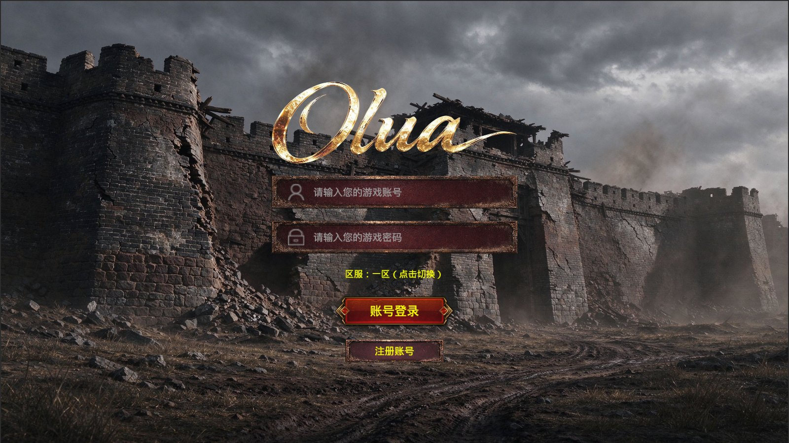
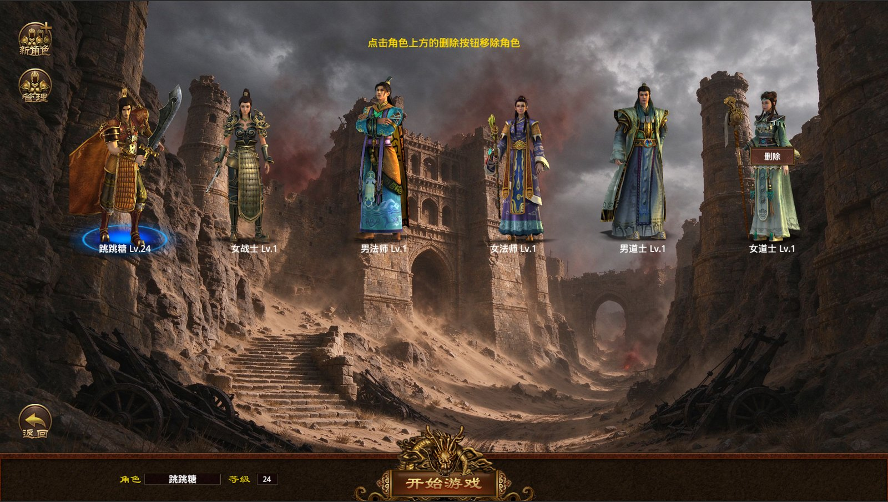
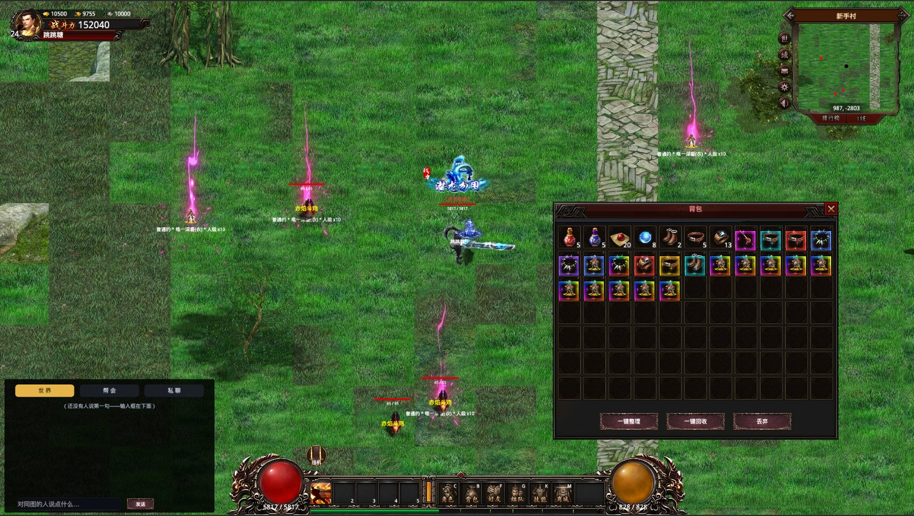
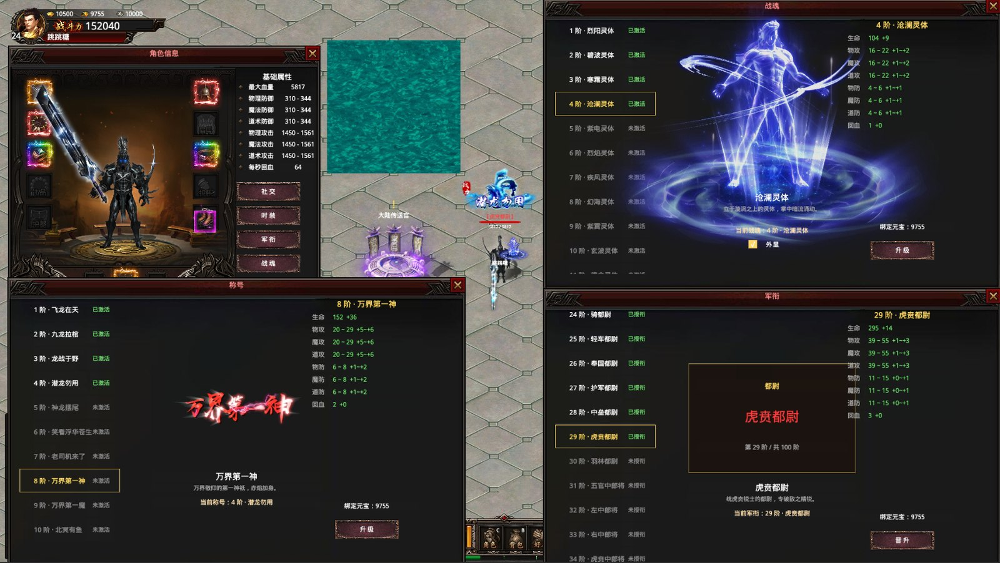
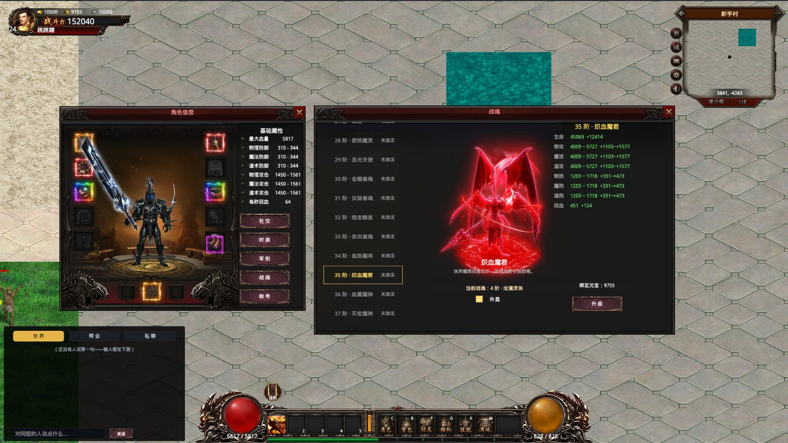
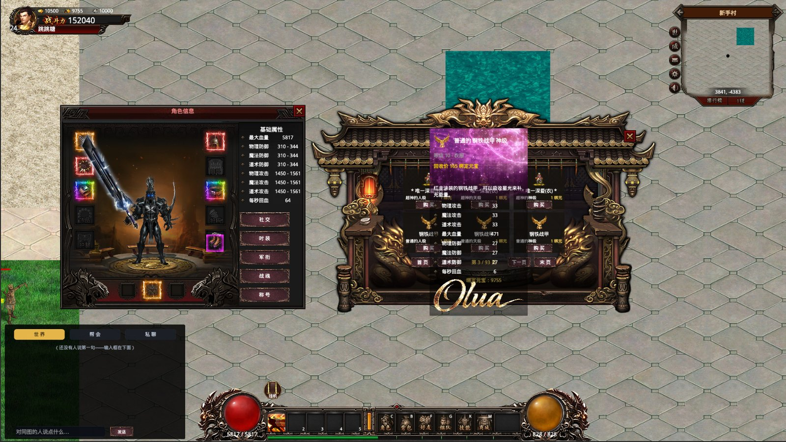
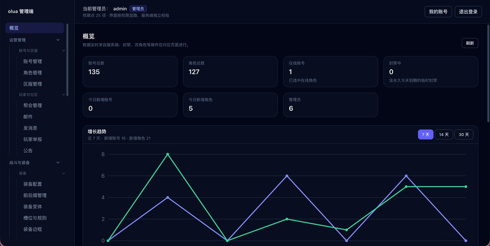
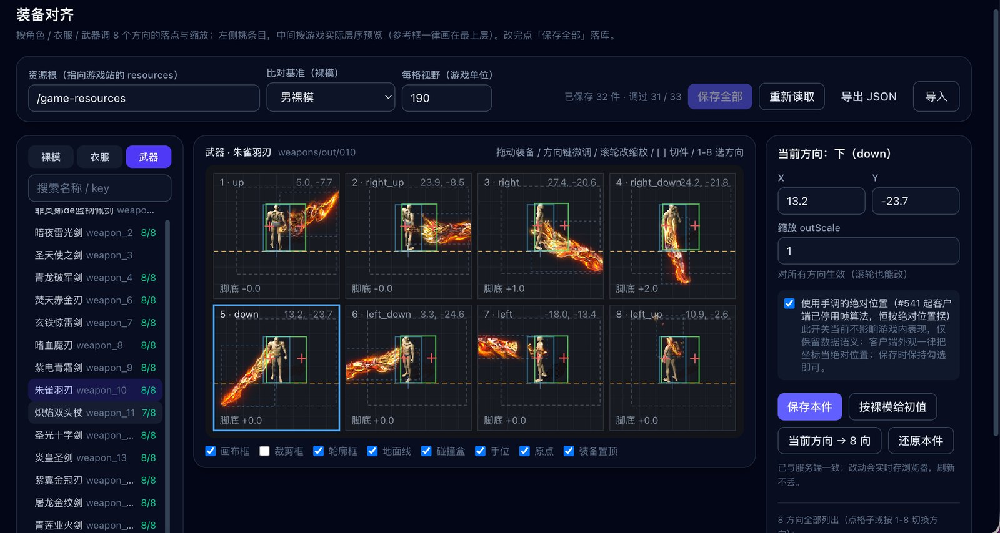
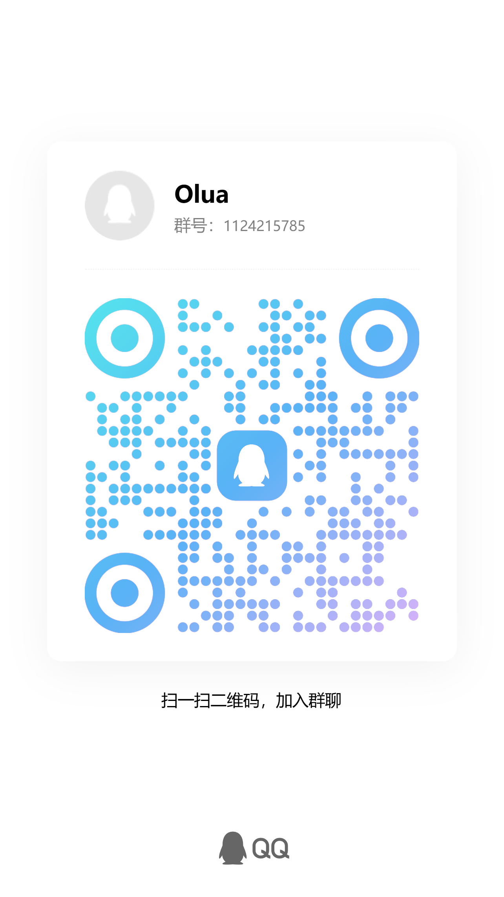

# olua

> [English](README.en.md) | 简体中文

**一个打开浏览器就能玩的 2D 角色扮演游戏。** 创建角色、跑地图、打怪、捡装备、升级、加帮会 —— 一整套玩法已经跑通，
不是演示片段。项目**免费开源**，任何人都能自己部署一套，也可以直接玩线上这一份。

| 想做什么 | 去哪里 |
| --- | --- |
| 立刻玩一把 | <https://game.yimw.cn>（网页版，不用下载） |
| 看看项目长什么样 | <https://yimw.cn>（官网：玩法、截图、架构、部署） |
| 进运营后台 | <https://admin.yimw.cn>（改配置、发公告、管账号） |

> 代码在 [GitHub](https://github.com/WebCoderT/olua)，[Gitee](https://gitee.com/putiwan/olua) 是只读镜像。
> 觉得有意思可以点个 **Star ⭐**。

## 这是个什么游戏

斜 45 度俯视的 2D 画面，键盘走位、鼠标点怪，玩法接近早年网吧里的传奇类网游，但把繁琐的部分都砍掉了：
没有复杂的合成表，没有必须氪金的数值墙，也不用组队才能玩。

你从选角界面创建一个角色，出生在新手地图，跟着 6 步引导学会走路、攻击、捡东西、开背包，
然后就可以自己决定往哪走：

- **想变强**：打怪有经验，升级会补满血蓝、解锁更高的地图；装备靠打怪掉落，也能在商城直接买。
- **想好看**：装备有前缀和后缀，同一件装备会因为词缀不同变成不同的品质，边框会发光、详情面板有专属背景动画。
- **想收集**：战魂 37 阶、称号 34 阶、军衔 100 阶，三条成长线各自加属性，也都显示在角色头上。
- **想热闹**：同屏能看到其他玩家，能加好友、拉黑、举报，能建帮会收人、发公告，还能组队一起打、经验按比例分。
- **想省事**：有自动战斗和寻路，点一下怪就自己跑过去打；背包有一键整理和一键回收。

死了不惩罚：原地复活，或者回城满血复活。

## 界面长什么样

<p align="center">
  
  
</p>
<p align="center">
  
  
</p>
<p align="center">
  
  
</p>

运营后台（浏览器打开，给运营改数据用的）：

<p align="center">
  
  
</p>

## 你能玩到什么

### 账号与角色

- 注册、登录、选服，一个账号最多 3 个角色，角色数据存在服务器上，换电脑继续玩。
- 进度自动保存：边玩边存，切地图和退出前会立刻再存一次，不会因为关页面丢进度。
- 选角界面可以删角色（两步确认，防手滑）。

### 地图与探索

- 多张地图，每张有自己的等级和战力门槛，不够会被传送官拦下并告诉你差多少。
- 进图有进度条；每张图有复活点，进出地图都从那里开始。
- 右上角小地图跟着你走，红点是怪物的真实位置；点小地图能放大，左键自动寻路、右键直接传送。
- 走路会绕开树和墙，不会卡在障碍物里。

### 打怪与战斗

- 键盘 WASD 移动，左键走、右键跑，点怪就攻击；也有屏幕摇杆，手机浏览器能玩。
- 技能有冷却和耗蓝，打出去有特效和飘字；怪也会放技能。
- 伤害由服务器计算，所有人看到的血量一致，不会出现「我这边打死了、你那边还站着」。
- 死了停住画面，可以原地复活，也可以回城满血复活。

### 成长

- 打怪拿经验，等级越高属性越强；等级差太多的小怪不给经验，避免一直刷新手怪。
- 战魂（37 阶）、称号（34 阶）、军衔（100 阶）三条线，花游戏里赚的元宝升级，加的属性都算进战斗力。
- 战斗力是一个数字，也是进高级地图的门槛。

### 装备与物品

- 装备分部位、分等级，穿上就加属性，换装立刻重算，外观也会跟着变（8 个方向都有）。
- 每件装备有「前缀 + 后缀」组合，品质不同，背包格子上的边框和详情页的背景会播放不同动画。
- 打怪掉装备：地上会出现光柱，品质越高越显眼，走过去自动捡。
- 背包能整理、能拖动、能一键回收成元宝，也能把不要的东西拖出窗口直接丢掉。
- 商城把全部装备自动上架，翻页挑、买了直接进背包；还有 20 件只换外观不改数值的时装。

### 社交

- 同屏能看到别的玩家，名字按关系上色：好友绿、队友金、同帮蓝、敌人红、拉黑灰。
- 好友要双方同意；敌人是单向的，对方不会收到通知。
- 帮会可以建、可以申请、可以审批，能踢人、转让、解散，帮主能改帮会公告。
- 队伍邀请即建队，队长带队，队长退出会自动移交；同图队友能分到经验。
- 排行榜分等级、战力、击杀三张，离线也留在榜上。
- 有成就系统，达成就领奖，背包满了奖励会转到游戏内邮件。

### 界面

- 血球、魔法球、经验条、快捷键栏、小地图一屏放得下。
- 弹窗点哪个哪个浮到最上层，不会互相遮挡点不到。
- 鼠标停在技能和状态图标上会显示说明和剩余时间。
- 第一次进游戏有 6 步新手引导，只高亮不挡操作。

## 自己搭一套

### 最省事：一台装了 Docker 的服务器

```bash
git clone https://github.com/WebCoderT/olua.git && cd olua
cp server/.env.example server/.env      # 至少填 JWT_SECRET 与 ADMIN_REGISTER_CODE 两个密钥
docker compose up -d --build
```

跑完会起五个容器：网站、管理后台、游戏、接口服务、实时服务，对外只开 80 和 8080。
域名、HTTPS、备份、升级、回滚等完整步骤见 [`docs/deploy.md`](docs/deploy.md)。

### 本机开发：三条命令

```bash
cd server && npm install && cp .env.example .env && npm run dev   # 接口 :3100
cd admin  && npm install && cp .env.example .env.development && npm run dev   # 后台 :5173
# 客户端用 Cocos Creator 3.8.7 打开 client/ 目录，点预览
```

服务端起好以后，打开 <http://localhost:3100/api-docs> 能看到全部接口文档；
后台第一次注册的账号自动是超级管理员。

> 游戏素材（2.4G）不在代码仓库里，打开 Cocos 工程前先按文末「素材」一节把资源下载下来。

## 这个项目是怎么写出来的

**每一行代码都是 AI 写的。** 人只做三件事：提需求、看效果、说不满意。

所以这个仓库除了游戏本身，也是一份「AI 能不能独立写完一个完整项目」的实测记录：
需求怎么拆、AI 写歪了怎么纠、哪些地方必须人来拍板，都留在提交历史和 `docs/` 里。

技术上它和常见的开源游戏项目没区别：客户端 Cocos Creator，服务端 NestJS，后台 React，数据库 SQLite。
区别在于**没有一行是人手敲的**。

## 给想改代码的人

仓库分成三个平级的端，各自有独立的 README 和常见问题：

| 端 | 是什么 | 用什么写的 | 目录 |
| --- | --- | --- | --- |
| 客户端 | 玩家玩的游戏 | Cocos Creator 3.8.7 + TypeScript | [`client/`](client/) · [README](client/README.md) |
| 服务端 | 存档、战斗结算、各种接口 | NestJS + SQLite | [`server/`](server/) · [README](server/README.md) |
| 管理端 | 运营改数据用的后台 | React + Vite + Tailwind | [`admin/`](admin/) · [README](admin/README.md) |

两条规矩值得先知道：

1. **服务器说了算。** 客户端的血、伤害、掉落、背包都只是显示，真正的数据在服务端；断线时客户端不会自己算一套假的。
2. **接口只写一遍。** 接口定义在服务端，客户端和后台的接口文件由工具自动生成，改字段忘了同步会直接编译报错。

常用命令（在仓库根执行，`make help` 看全部）：

```bash
make install        # 装依赖
make dev            # 同时起服务端和后台
make check          # 类型检查 + 跨端审计
make test           # 客户端单测 + 服务端端到端测试
make verify         # 提交前跑这个：上面全部 + 三端构建
```

更细的文档：

| 文档 | 内容 |
| --- | --- |
| [`docs/`](docs/README.md) | 40 篇代码文档：每条链路从数据库讲到屏幕 |
| [`FAQ.md`](FAQ.md) | 常见问题：为什么这么设计、踩过哪些坑 |
| [`website/`](website/index.html) | 官网：玩法细节、架构图、工程管理、设计取舍 |

## 许可

[MIT](LICENSE)：可以自由修改、分发，也可以商用，保留版权声明即可。
商用产生的一切工作（部署、扩容、合规、售后）由使用者自己承担，作者不提供免费的技术支持。
问题欢迎提 issue，但不保证响应时间。

## 素材

游戏素材有 2.4G，**有意不放进代码仓库**，改用「清单 + GitHub Release 分卷」分发：
清单 `resources.manifest.json` 随代码提交，分卷 zip 挂在 tag 为 `resources-<版本号>` 的 Release 上。

```bash
make resources-verify                    # 拉完代码先核对本地素材与清单是否一致
make resources-download VERSION=<版本号>  # 不一致或新机器：下载、解压、自动校验
```

改完素材要发布时：`make resources-manifest` → `make resources-pack` → `make resources-upload`（需 `gh` 已登录）。

## 联系


