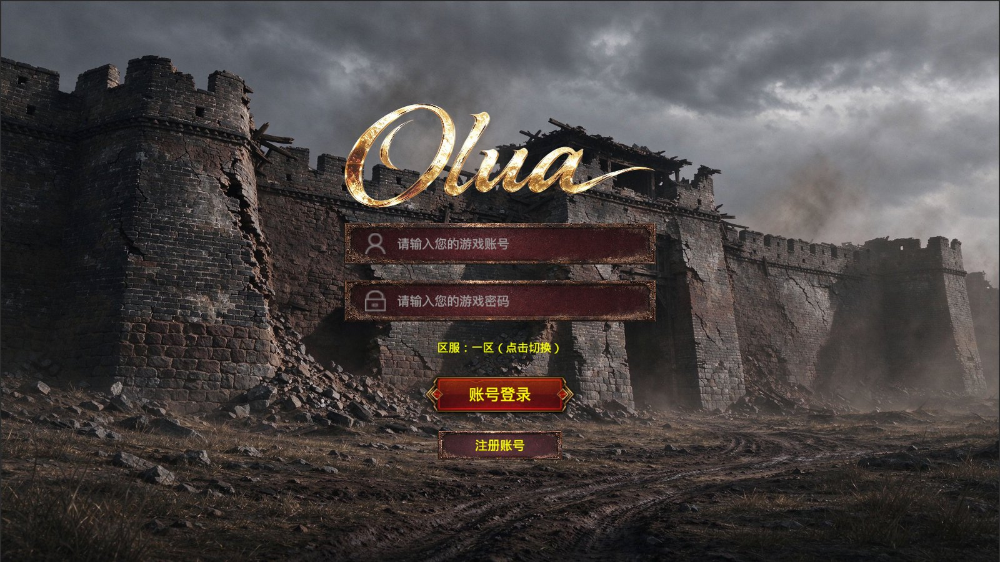
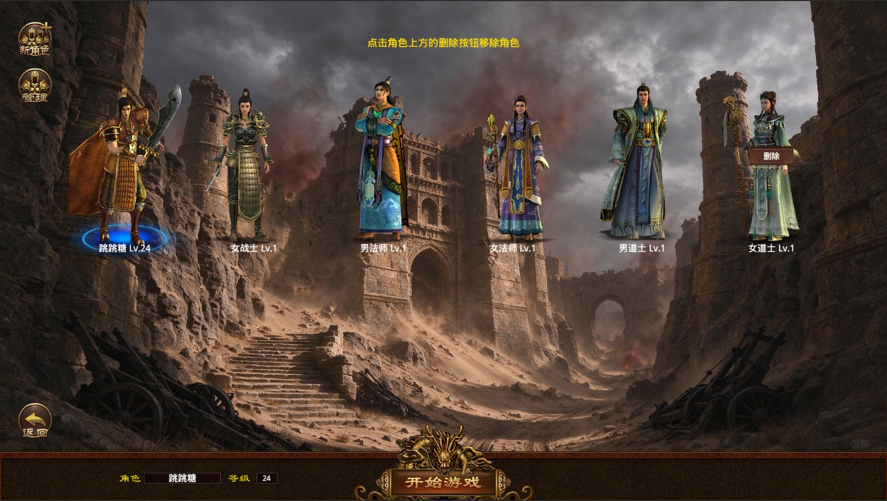
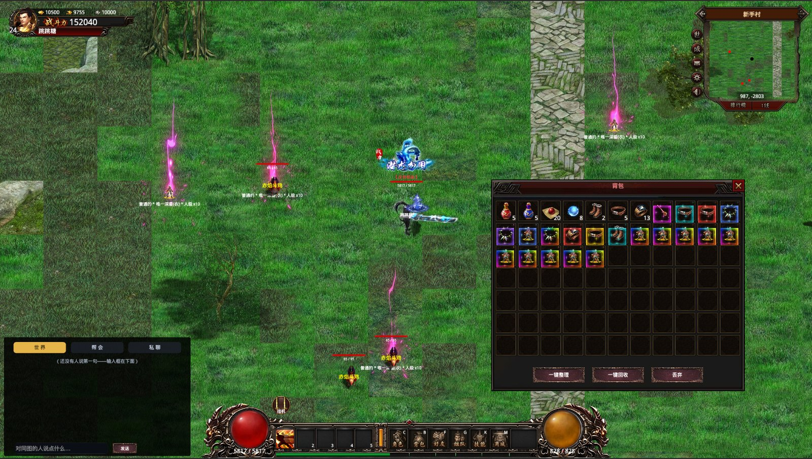
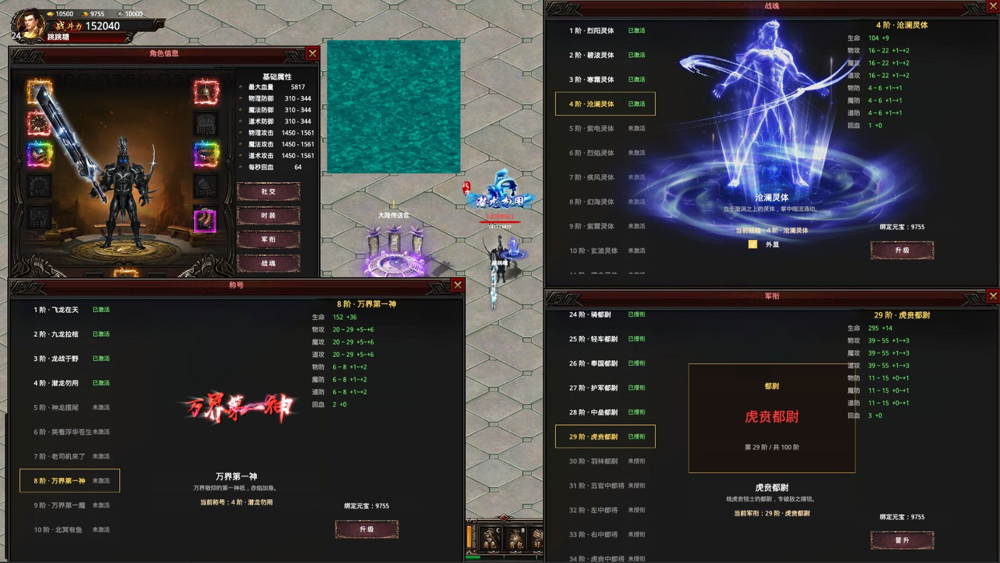
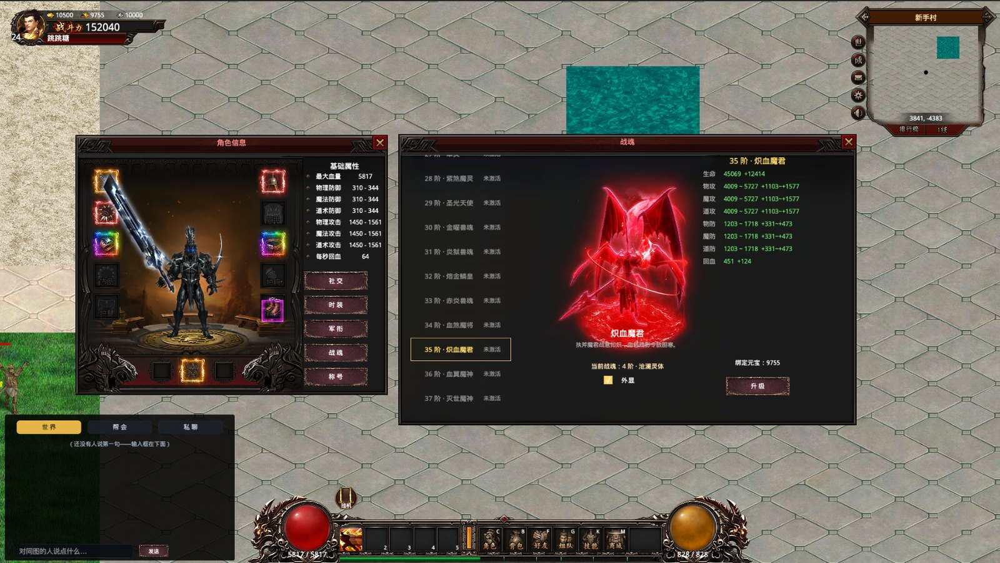
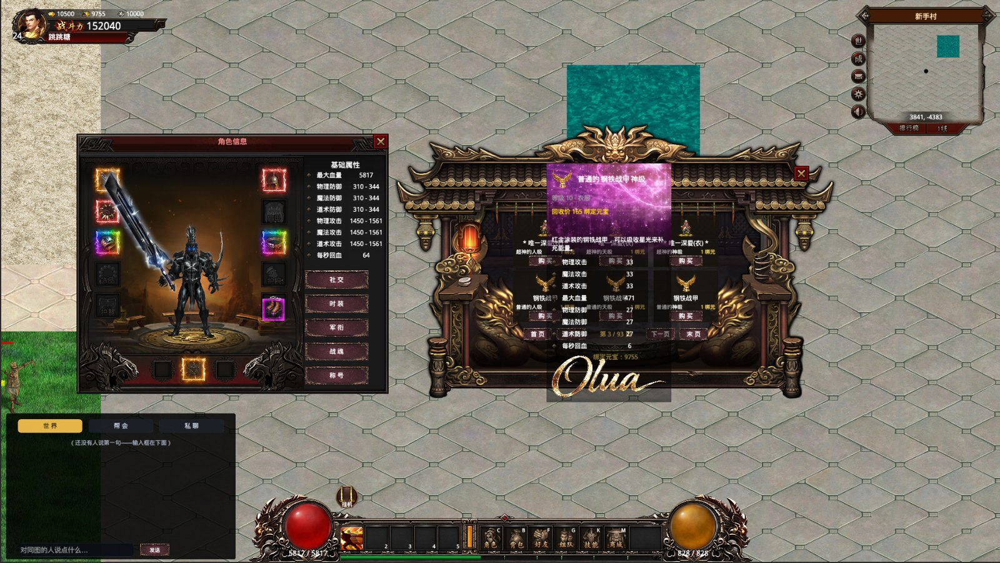
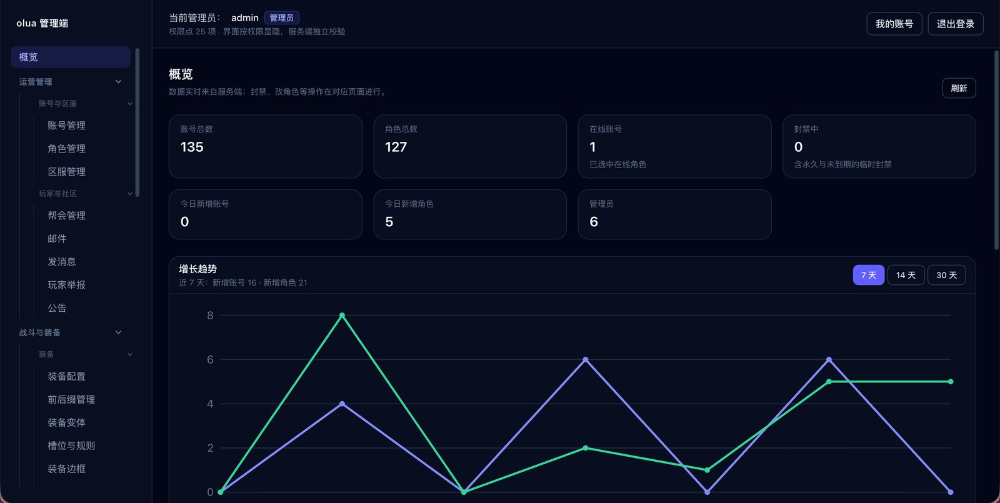
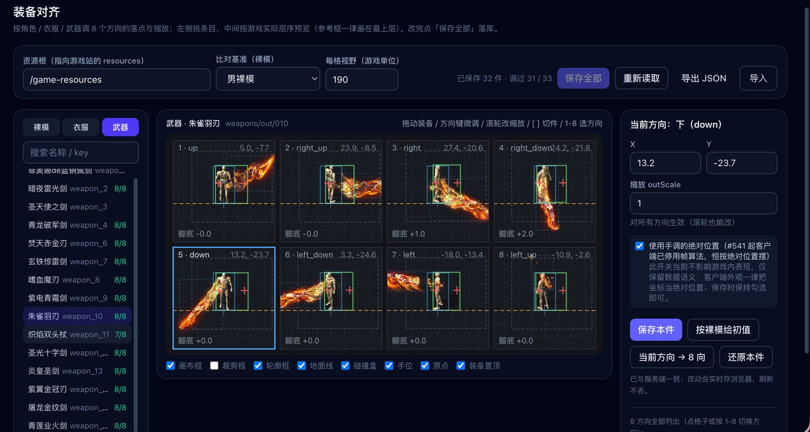
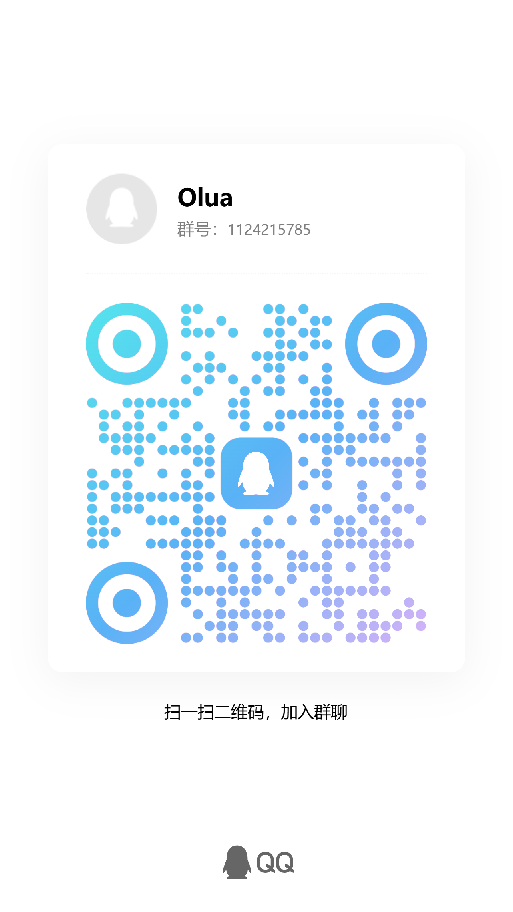

# olua

> [English](README.en.md) | 简体中文

> **纯 AI 编写的学习项目（Vibe Coding）**：仓库里每一行代码都是 AI 写的，人只提需求、看效果。
> **不是可以直接上线运营的游戏** —— 几个做开发、做 AI 的人凑在一起学习研究的项目。

一个基于 Cocos Creator 3.8.7 的 2D 角色成长与装备玩法原型，配套 NestJS 服务端与 React 管理后台：
三端跑通登录、建号、成长、装备、地图探索与战斗。

**免费、开源，任何人都能自己部署一套**。线上有可访问的实例：

| 地址 | 是什么 |
| --- | --- |
| <http://yimw.cn> | 官网（项目概览 / 数据流 / 工程管理 / 设计思路 / 部署） |
| <http://game.yimw.cn> | 游戏客户端（Web 版，打开即玩） |
| <http://admin.yimw.cn> | 运营后台 |

想要自己的服务器上跑一套，看 [`docs/deploy.md`](docs/deploy.md) 与 [官网部署页](http://yimw.cn/deploy.html)。

主仓在 **GitHub**（`github.com/WebCoderT/olua`），Gitee 上的 [putiwan/olua](https://gitee.com/putiwan/olua) 是只读同步镜像：
代码、issue、PR、CI 都只在 GitHub 上进行（镜像定期同步，有延迟，以 GitHub 为准）。

[](https://gitee.com/putiwan/olua/stargazers)
[](https://gitee.com/putiwan/olua/members)

> 如果这个项目对你有帮助（思路、架构、AI 协作方式），欢迎在 [GitHub](https://github.com/WebCoderT/olua) 或 [Gitee](https://gitee.com/putiwan/olua) 上点个 **Star ⭐** —— 这是对纯 AI 编写学习项目最大的鼓励，也是项目继续更新的动力。

## 三个端

仓库按端分成三个**平级目录**，各自有独立的 README 与 FAQ。

| 端 | 是什么 | 技术栈 | 目录 | 文档 |
| --- | --- | --- | --- | --- |
| **客户端** | Cocos Creator 游戏（登录 / 选角 / 战斗 / 背包 / 商城…） | Cocos Creator 3.8.7 + TypeScript | [`client/`](client/) | [README](client/README.md) · [FAQ](client/FAQ.md) |
| **服务端** | 账号 / 角色 / 管理接口，SQLite 落库，Swagger 文档 | NestJS 12 + `node:sqlite` + JWT | [`server/`](server/) | [README](server/README.md) · [FAQ](server/FAQ.md) |
| **管理端** | 运营后台（账号 / 角色 / 公告 / 日志 / 地图） | React 19 + Vite + Tailwind v4 | [`admin/`](admin/) | [README](admin/README.md) · [FAQ](admin/FAQ.md) |

客户端是玩家玩的游戏，服务端是唯一的权威数据源（本地只是缓存），管理端给运营改数据。
接口契约由服务端单向生成到另外两端：

```
client（Cocos）  ─┐
                  ├─→  server（NestJS + SQLite）  ←─  admin（React）
admin（React）   ─┘       ↑ 唯一手写接口的地方
                          └─ swagger:emit → openapi.json → gen-api → 两端接口文件
```

## 游戏截图

<p align="center">
  
  
</p>
<p align="center">
  
  
</p>
<p align="center">
  
  
</p>

**管理端**（运营后台，浏览器打开）：

<p align="center">
  
  
</p>

> 截图覆盖登录 / 选角 / 战斗 / 装备 / 商城与管理端。更多界面见
> [官网](website/index.html) 的「跑起来是这样」，或自行下载运行查看。
> 官网还有三块偏工程的内容：**架构与数据流**（五条主链路 + 契约管线 + 数据四层）、
> **工程管理**（研发流程 / CI 门禁 / 39 套 e2e / 15 项审计）、**设计思路**（十二条决策及其代价）。

## 快速开始

最短跑通路径。各端的详细说明与全部环境变量见各自的 README。

### 1. 服务端（先跑起来，客户端与管理端都依赖它）

```bash
cd server
npm install
cp .env.example .env     # 首次：端口 / 密钥 / 上限都在这里，注释里逐项说明
npm run dev              # 开发（热编译）；或 npm run start 跑已构建产物
```

- 接口文档：<http://localhost:3100/api-docs>（JSON 在 `/api-docs-json`）
- 健康检查：<http://localhost:3100/api/health>
- **手机 / 另一台电脑连进来**：`SERVER_HOST` 留空即听所有网卡，启动日志会直接列出可用地址；
  客户端与管理端的接口地址会自动跟着「页面所在主机」走，不需要改任何配置
- 一条命令全验：`npm run verify`

### 2. 客户端（Cocos）

1. 安装并打开 Cocos Creator 3.8.7。
2. 通过 Creator 的 “Open” / “Open Project” 打开 **`client/`** 目录（它才是 Cocos 工程根）。
3. 在编辑器中打开 `client/assets/scenes` 下的场景文件。
4. 用预览或播放按钮运行。

客户端没有 npm 脚本，依赖 Cocos Creator 编辑器启动与预览。
连哪个服务端只由 `client/assets/configs/network.ts` 的 `baseUrl` 决定（真机调试改成局域网 IP）。

### 3. 管理端（React）

```bash
cd admin
npm install
cp .env.example .env.development   # 首次：接口根地址在这里（VITE_API_BASE_URL）
npm run dev                        # 开发；npm run build 产出 dist
```

管理端注册需要在 `server/.env` 里配 `ADMIN_REGISTER_CODE`（留空则开放注册），注册时填同一个注册码。
**第一个**注册的管理员自动成为超级管理员（全部权限），之后的由超管在「管理员」页提权。

### 4. 改接口 = 改服务端 + 重新生成

客户端与管理端**不手写任何接口文件**：路径、方法名、请求 / 响应类型全部从服务端的 Swagger 文档产出。
这样「服务端改一个字段、另外两端忘了改」会变成**编译报错**，而不是线上出现一个 `undefined`。

```bash
cd server && npm run gen:api     # = swagger:emit + node ../tools/gen-api.cjs
```

```
server/src（控制器 + DTO + 装饰器）           ← 唯一需要手写的地方
        │  cd server && npm run swagger:emit
        ▼
server/openapi.json（机器可读契约，提交进仓库）
        │  node tools/gen-api.cjs
        ▼
客户端 client/assets/ui/utils/net/{ApiRoutes,ApiModels,Api}.ts
管理端 admin/src/api/{routes,models,endpoints}.ts
```

改接口的标准动作：改服务端控制器 / DTO / 装饰器（每个接口要有 `operationId`）→ `npm run gen:api` →
两端 `tsc` / `npm run build`，签名不兼容会直接报错。**生成物禁止手改**，`tools/audit-api-generated.cjs` 会盯着。

## 常用命令

仓库根有一份 Makefile，把三端的常用动作收在一处（`make help` 列出全部）：

```bash
make install        # 首次：装 server / admin 的依赖
make env            # 生成 server/.env（已存在则跳过）
make dev            # 同时起服务端 :3100 与管理端 :5173，Ctrl-C 一起退出

make client-check   # 客户端类型检查（Cocos 自带 tsc，0 错才算过）
make client-test    # 客户端单测
make server-verify  # 服务端一条命令全验（编译 + e2e + 生成物审计）
make admin-build    # 管理端类型检查 + 构建
make gen-api        # 改完接口后重新生成契约与两端接口文件
make audit          # 跨端审计脚本

make check          # 静态检查：客户端 tsc + 管理端 typecheck + 审计
make test           # 全部测试：客户端单测 + 服务端 e2e
make verify         # 完整门禁：check + 三端构建 + 全部测试（提交前跑这个）
```

- 单跑一套客户端单测：`make client-test-one T=test-bag-tidy`
- 换机器 / 换 Cocos 版本：`make TSC=/path/to/tsc client-check`
- 受限终端（被注入了 `NODE_OPTIONS`）不用特殊处理 —— Makefile 已统一清掉

## 资源同步（resources 不入库）

`client/assets/resources/` 体积大，**有意不进版本库**。多人 / 多机靠「清单锁 + GitHub Release 分发」保持一致：

- **清单**：`resources.manifest.json` 提交进仓库，记录每个文件的 sha1 + 大小（含 `.meta` —— Cocos uuid 绑在 meta 上）。
- **分发**：分卷 zip 挂在 GitHub Release（tag = `resources-<版本号>`）。

```bash
make resources-verify                      # 拉代码后先跑：本地资源 vs 清单
make resources-download VERSION=<v>        # 不一致或新机器：下载分卷、解压、自动校验
```

改完资源后由改动者发布：`make resources-manifest` → `make resources-pack` → `make resources-upload`（需 `gh` 已登录）。
约定：**先合并带新清单的 PR，再跑 upload**。

## 功能清单

只列**已实现**的功能；服务端与管理端的细粒度能力见各自 README。

### 账号与角色

| 功能 | 说明 |
| --- | --- |
| 账号注册 / 登录 | 账号存服务端，口令 scrypt 加盐摘要，令牌 7 天有效 |
| 角色选择与创建 | 每账号最多 3 个角色，列表与数据都在服务端 |
| 进度云端保存 | 改动防抖 1.5 秒合并推送，切图与退出前立即补推 |
| 旧存档自动迁移 | 新增字段读取时自动补齐 |
| 删除角色 | 选角界面两步确认，由服务端删除 |
| 后台账号与角色管理 | 多条件筛选、结构化编辑、批量删除、重置口令、踢下线 |
| 操作日志 | 管理端写接口自动留痕，口令类字段落库前打码 |
| 权限管理 | 超级管理员 / 管理员 / 只读观察员，权限点粒度到接口 |
| 公告与邮件触达 | 生效时间窗由服务端判定；邮件入队后由调度器投递、失败重试 |
| 登录限流 | 按用户名与来源 IP 两个维度计数 |

### 地图与场景

| 功能 | 说明 |
| --- | --- |
| 场景切换与 Loading 过渡 | 换图带进度显示 |
| 后台配置驱动 | NPC 点位、复活点、矩形刷怪区、**碰撞盒**由管理端「地图管理」直接放 / 拖 / 画（#667 / #672 / #676 起 TMX 不再是它们的来源） |
| TMX 资源驱动 | 瓦片、底图、预览图随资源包发布 —— **地图文件只做显示**（#676 起 TMX 里连对象组都没有了，只剩瓦片与图层） |
| 复活点出生 | 进图与传送统一从复活点出生（每图一个，后台可设可清） |
| 小地图 | 底图按视野等比缩放、随角色平移，红点即怪物真实位置 |
| 小地图预览弹窗 | 大图预览，左键自动寻路、右键直接传送 |
| 地图传送官 | 按地图类型分组，条件未达标时提示原因 |
| 地图玩法配置 | 名称 / 类型 / 进入等级 / 战力 / 战魂阶在管理端改，保存即生效 |
| 碰撞范围调试 | 开关控制显示碰撞框 |

### 角色成长

| 功能 | 说明 |
| --- | --- |
| 等级与属性成长 | 按等级生成攻防区间与战斗力 |
| 击杀经验 | 按等级差衰减，差 6 级以上无经验 |
| 升级流程 | 属性重算、血蓝补满、升级特效 |
| 战魂 | 37 阶成长线，绑定元宝升级，属性计入战力与地图门槛 |
| 称号 | 34 阶成长线，名牌常显角色头顶 |
| 军衔 | 100 阶成长线，红字常显血条上方 |
| 每秒回血 | 由等级、防御装备、战魂、称号、军衔共同相加 |
| HP / MP | 血球魔法球、头顶血量实时刷新、魔法自然回复 |

### 装备与物品

| 功能 | 说明 |
| --- | --- |
| 装备穿脱与属性汇总 | 校验等级 / 性别 / 职业，换装实时重算 |
| 内外观 | 8 方向外观位置与缩放，未穿衣服按性别显示默认身体 |
| 前后缀变体 | 前缀 5 档 × 后缀 3 档，每件 15 个变体，共 555 件 |
| 品质边框与详情背景 | 按前后缀组合播放边框与背景动画 |
| 掉落 | 服务端按权重表抽、抽完直接入包；客户端只演同心环散落与拾取动画 |
| 每怪独立掉落表 | 一只怪一份列表，条目逐条配权重 / 概率 / 数量 |
| 掉落光柱 | 装备落地按前缀品质播放光柱；摆位 / 缩放 / 旋转 / 时长 / 开关在管理端「特效管理」调（`light-1`…`light-6`） |
| 背包整理 | 合并可叠加物并按等级 / 部位重排，纯函数可单测 |
| 背包拖动 / 回收 / 丢弃 | 换格、一键回收为绑定元宝、拖出弹窗整格销毁 |
| 商城 | 全部装备自动上架，卡片分页浏览，购买直接进背包 |
| 时装 | 20 件，只换外观不换数值 |

### 战斗与技能

| 功能 | 说明 |
| --- | --- |
| 技能系统 | 统一触发入口，冷却 / 耗蓝 / 距离校验 |
| 键盘 + 鼠标双操控 | WASD 移动，左键走右键跑，点怪攻击 |
| 自动战斗 | 快速攻击与挂机开关，A* 寻路绕障碍 |
| 伤害结算上移服务端 | 服务端按共享快照算伤害，castId 幂等，客户端只做表现 |
| 突进技能 | 按鼠标落点瞬移并播放落地特效 |
| 状态 Buff | 技能附加状态、身上循环特效、图标倒计时 |
| 怪物技能 | 服务端 AI 释放，客户端只演特效 |
| 多人同屏 | 同图玩家互见外观与血量，按 200ms 增量广播 |
| 路线指示线 | 自动寻路期间大地图与小地图同步画白色点状路线 |

### 怪物、死亡与复活

| 功能 | 说明 |
| --- | --- |
| 区域刷怪 | 服务端按地图刷怪矩形随机生成（客户端进图只登记，不自己刷） |
| 世界权威 | 怪物实例服务端持有，跨账号共享，状态落盘跨重启恢复 |
| 怪物 AI | 待机游走、主动追击、受伤激怒、普攻结算 |
| 死亡动画 | 倒地播完才移除节点 |
| 死亡与复活 | 停帧锁操控，原地复活或回复活点安全复活 |

### 帮会与社交

| 功能 | 说明 |
| --- | --- |
| 帮会 | 创建 / 申请 / 审批 / 成员 / 踢人 / 转让 / 解散 |
| 队伍 | 邀请即建队，队长是唯一写者，队长退出自动移交 |
| 组队分经验 | 同图队友得 50%，异图与等级差过大分不到 |
| 好友与敌人 | 好友双向镜像，敌人单向且对方不知情 |
| 屏蔽与举报 | 过滤在服务端，举报落库不处罚 |
| 排行榜 | 等级 / 战力 / 击杀三榜，名次服务端算，离线也上榜 |
| 成就 | 累计型记账、状态型现算，领取发奖，背包满转邮件 |
| 游戏内邮件 | 收件箱与附件领取，按系统 / 奖励 / 社交 / 战斗分栏 |
| 名字按关系配色 | 拉黑灰、敌人红、队友金、同帮蓝、好友绿 |

### 界面与系统

| 功能 | 说明 |
| --- | --- |
| HUD | 角色信息栏、血球、魔法球、经验条、快捷键栏、小地图 |
| 弹窗层级 | 同屏多个弹窗时点哪个哪个浮到最上层 |
| 悬停详情 | 状态与技能格显示名称 / 介绍 / 剩余时间 |
| 操作摇杆 | 拖得少走路、拖得多跑动 |
| 屏幕适配 | 单一分辨率 1920×1080，比例不符等比缩放留黑边 |
| UI 点击不穿透 | 界面拦下抬起时交还世界侧，不卡住行走 |
| 资源预加载 | 进图前预载地图 / NPC / 怪物 / 外观帧动画 |
| 新手引导 | 6 步，遮罩不拦点击，进度存角色存档 |
| 公告展示 | 登录页弹重要公告，游戏内入口带未读红点 |

## 目录结构

```
olua/
├── README.md · FAQ.md      # 总览与跨端问题（本文件）
├── client/                 # 客户端：Cocos Creator 工程（用它打开这个目录）
├── server/                 # 服务端：NestJS
├── admin/                  # 管理端：React
├── tools/                  # 项目级脚本（跨端）
├── website/                # 项目官网（纯静态多页：概览 / 架构 / 工程 / 设计）
├── docs/                   # 部署说明
└── resources_dist/         # 素材清单（发布用）
```

各端内部的目录与约定见各自 README。两条全局约定：**客户端一切可调的东西都收在 `assets/configs`**（数值、文案、布局、配色、时长、资源路径都不写进逻辑）；**接口文件全部由服务端生成**，三端签名对不上会编译报错。

## 技术栈

- Cocos Creator 3.8.7 + TypeScript + Box2D 物理
- 服务端：NestJS 12 + `node:sqlite`（Node 22 内置，无原生模块依赖）+ JWT + Swagger
- 管理端：React 19 + TypeScript + Vite + Tailwind CSS v4
- 存储：SQLite WAL 单库共享，多进程各写各的表（理由见 [FAQ](FAQ.md)）
- 开发方式：全部由 AI 编写（Vibe Coding），人类只提需求与验收

## 文档

| 文档 | 内容 |
| --- | --- |
| [README.md](README.md) | 本文件：三端索引、快速开始、功能清单 |
| [website/](website/index.html) | 项目官网：概览、架构与数据流、工程管理、设计思路、玩法细节、部署 |
| [FAQ.md](FAQ.md) | 跨端：地址唯一来源、契约管线、环境坑、回归怎么跑 |
| [client/README.md](client/README.md) · [client/FAQ.md](client/FAQ.md) | 客户端：工程怎么打开、架构与约定、预览报错 |
| [server/README.md](server/README.md) · [server/FAQ.md](server/FAQ.md) | 服务端：启动与环境变量、数据模型、认证与权限 |
| [admin/README.md](admin/README.md) · [admin/FAQ.md](admin/FAQ.md) | 管理端：启动与构建、权限显隐、页面清单 |

## 许可与商业化

- 本项目采用 **[MIT 协议](LICENSE)** 开源。
- **允许商业化**：你可以自由地修改、分发、部署本项目的代码并用于商业用途，只需保留原版权声明与许可文本。
- **不提供任何免费商业化支持**：将本项目用于商业目的（开服运营、二次开发销售、对外提供技术服务等）产生的所有工作（部署、调优、扩容、合规、售后等）由使用者自行承担，作者不承担任何义务，也**不接受任何形式的免费商业化咨询与技术支持请求**。
- 问题反馈仅限开源社区渠道：欢迎提 issue 与 PR，但不保证响应时间，更不构成任何支持承诺。

## 素材与联系方式

素材体积过大无法纳入版本控制，如果需要请联系我。


